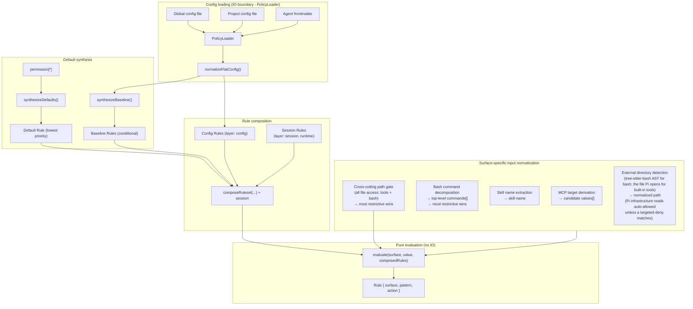
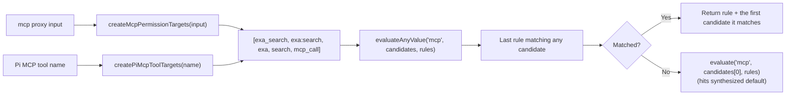
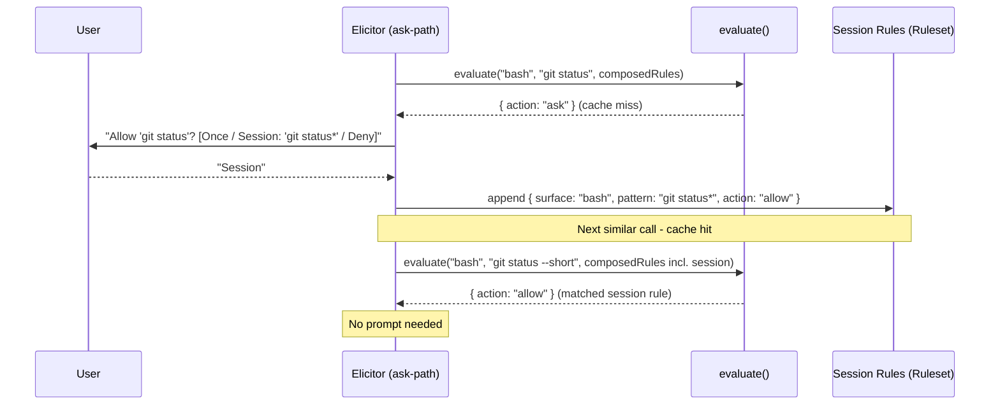

# Architecture

This document describes the internal design of the permission system, informed by [OpenCode's permission model](https://opencode.ai/docs/permissions/).

## Design principles

1. **Unified rule model** - one `Rule` type, one evaluation function, all surfaces.
2. **Pure evaluation** - permission decisions are pure functions of (surface, pattern, rules).
   IO stays at the edges.
3. **Session approvals are just more rules** - no separate matching engine, no separate pre-check.
4. **MCP stays special** - multi-name target derivation is pre-processing, not a special evaluation path.
5. **Defaults are rules** - the universal default (`permission["*"]`) is synthesized as a low-priority rule in the array.
   No side-channel fallbacks.
6. **Flat config format** - the flat `permission: { ... }` object where each key is a surface.
   The config IS the ruleset in human-friendly form.
   Capability is a suffix on the surface name, not a nested facet (`path_read`, `external_directory_write`), and a bare `path` / `external_directory` key is load-time sugar expanding into both directions — so every channel keeps speaking one flat `(surface, pattern)` vocabulary ([ADR-0013](../decisions/0013-permission-policy-model.md) §3, §4).
7. **Preserve the two-phase model** - tool filtering (before_agent_start) and invocation gating (tool_call) remain separate.
8. **Ask = cache miss** - "ask" is the absence of a matching rule.
   The human is the oracle.
   Their decision is a rule.
   Persistence determines lifetime (once / session / config).
9. **Single-agent core, multi-agent by extension** - Pi is single-agent by deliberate design; the notion of multiple named agents is introduced entirely by external extensions (pi-subagents, pi-agent-router, some MasuRii packages), not by Pi itself.
   Per-agent `permission:` frontmatter is therefore an extension bridge layered on this single-agent core, not a core responsibility.
   The package learns the active agent from a generic `<active_agent>` signal (a system-prompt tag or an `active_agent` session entry), never from a hard dependency on any one multi-agent extension, so the bridge works with any tool that emits the signal.

## Scope and non-goals

The README carries a short charter for the boundaries that come up most often.
This is the full inventory, with the decision record or design principle each rests on.

| Non-goal                                                                             | Rests on                                                                                |
| ------------------------------------------------------------------------------------ | --------------------------------------------------------------------------------------- |
| Implementing isolation — this decides and records; a sandbox contains                | [ADR-0013](../decisions/0013-permission-policy-model.md) §8                             |
| Deciding project trust — a policy enforcer, not a trust oracle                       | [ADR-0001](../decisions/0001-project-trust-adoption.md)                                 |
| Sanitizing the config merge so a project scope can only tighten                      | [ADR-0001](../decisions/0001-project-trust-adoption.md)                                 |
| Shipping permissive defaults, trust profiles, or workflow-mode presets               | Operator position; `docs/opencode-compatibility.md` divergence table                    |
| Built-in secret or sensitive-path denylists                                          | [ADR-0010](../decisions/0010-permission-log-secret-exposure.md)                         |
| Value-shape or entropy secret detection in the logs                                  | [ADR-0010](../decisions/0010-permission-log-secret-exposure.md)                         |
| Redacting the permission prompt or the forwarded request                             | [ADR-0010](../decisions/0010-permission-log-secret-exposure.md)                         |
| Disabling the review log by default, or gating `command` behind a flag               | [ADR-0010](../decisions/0010-permission-log-secret-exposure.md)                         |
| A downstream log-redactor registry                                                   | [ADR-0010](../decisions/0010-permission-log-secret-exposure.md)                         |
| Reading ambient host state (`cygpath`, MSYS detection) to interpret paths            | [ADR-0003](../decisions/0003-git-bash-posix-path-semantics.md)                          |
| Per-command argument tables in the deterministic bash layer                          | [ADR-0009](../decisions/0009-bash-path-projection-completeness-contract.md)             |
| Flooring every unprovable bash token to `ask`                                        | [ADR-0009](../decisions/0009-bash-path-projection-completeness-contract.md)             |
| Making the permission manager path-aware                                             | [ADR-0002](../decisions/0002-path-values-string-boundary.md), lint-guarded              |
| Making an LLM call, or holding model provider/prompt/threshold config                | [ADR-0007](../decisions/0007-model-judge-authorizer-chain-adr.md) §5                    |
| Letting an authorizer link `allow` on `external_directory` or a secret-shaped `path` | [ADR-0007](../decisions/0007-model-judge-authorizer-chain-adr.md) §5                    |
| Opt-out authorizer activation                                                        | [ADR-0007](../decisions/0007-model-judge-authorizer-chain-adr.md) §4                    |
| Running authorizer links on a relaying node, or a process-global registry            | [ADR-0007](../decisions/0007-model-judge-authorizer-chain-adr.md) §7                    |
| Re-deriving a forwarded request's facts at the parent                                | [ADR-0008](../decisions/0008-cross-session-access-intent.md)                            |
| A permanently tolerant dual-path wire, or a hard deny on a skewed request            | [ADR-0008](../decisions/0008-cross-session-access-intent.md) §4                         |
| Truncating or width-capping the assembled prompt message                             | [ADR-0011](../decisions/0011-prompt-presentation-contract.md) §2                        |
| Broadcasting evidence or annotations on `permissions:ui_prompt`                      | [ADR-0011](../decisions/0011-prompt-presentation-contract.md) §6                        |
| Returning model-generated annotations to the agent                                   | [ADR-0011](../decisions/0011-prompt-presentation-contract.md) §7                        |
| Echoing the agent's own tool input back in denial text                               | [ADR-0011](../decisions/0011-prompt-presentation-contract.md) §7                        |
| An in-package display for every operator's ideal (diffs, explanations)               | [ADR-0011](../decisions/0011-prompt-presentation-contract.md) §8                        |
| General agent steering from the permission dialog                                    | Operator position (issue #328)                                                          |
| Outbound bridges into another named extension's event contract                       | §"Beyond the target: a pluggable escalation seam", by analogy                           |
| A yolo mode that overrides explicit denies                                           | §"yolo is recorded authority"                                                           |
| A hard dependency on any one multi-agent extension                                   | Design principle 9                                                                      |
| A special evaluation path for MCP, or side-channel fallbacks                         | Design principles 4 and 5                                                               |
| OpenCode's top-level `"permission": "allow"` string shorthand                        | `docs/opencode-compatibility.md` divergence table                                       |
| A model that classifies access intent before `evaluate()`                            | §"Beyond the target"; [ADR-0007](../decisions/0007-model-judge-authorizer-chain-adr.md) |
| Supporting a non-Pi host that loads Pi extensions                                    | Operator position (#922)                                                                |

Three entries rest on an operator position rather than a decision record, and are marked as such above.
The host boundary is a line between two kinds of change, not a refusal to accept fixes: a payload that violates a contract this package already reads is normalized defensively, while a foreign host's bespoke tool formats, host-only tools, and separate approval authority are each declined.

The following are **not** boundaries, and must not be written as such.
Durable persistence of an approval is anticipated by design principle 8 and §"Authority lives in three places", which reserve a place for a ruling that outlives the session.
Whether a capability model replaces the actor-keyed surface list is settled: [ADR-0013](../decisions/0013-permission-policy-model.md) adds read/write capability as an axis beside the existing keys, so direction becomes expressible on `path` and on the boundary.
Which channels policy may enter through remains open in issue #799.
Multi-hop escalation, three-way grant scope, terminal-replacement registration, and non-TUI presentation are admitted-not-shipped or externally blocked, not declined.

### What would make a second host a goal

The host boundary is conditional, and the conditions are about verifiability rather than effort.
All five would have to hold; the first and the last are not this package's to satisfy.

1. **The host publishes a versioned extension-API contract.**
   Today a host adapts by rewriting imports at load time and nothing declares which extension-API version it implements, so every divergence is learned from a user's bug report.
   A stated contract is what makes a compatibility claim a claim about something.
2. **The suite executes against that host in CI.**
   A permission system's value is that its guarantees hold, so an unexecuted compatibility claim is worse than a declined one.
   This means a second lane on the host's runtime, not a mock of it.
3. **Host-only tools have a policy vocabulary.**
   A host that ships a persistent interpreter, browser control, or an editor-protocol client introduces permission surfaces with no rules, no defaults, and no documented recipes.
   They resolve to `ask` today through the universal fallback, which is safe but not expressible — a user cannot write policy about them.
4. **The dual-authority question is settled.**
   A host with its own approval layer makes this package a second authority over the same tool call, and the composition of the two — which prompts, which wins, whether an auto-approve mode bypasses these gates — has to be decided before either can be trusted.
   Getting it wrong is a silent bypass, which is this package's worst failure mode.
5. **A maintainer who uses that host owns the lane.**
   Nobody here runs it, so without an owner the lane rots into a green check that proves nothing.

Condition 1 is the one that currently fails hardest, and it is measurable.
Measured 2026-09-19 against Oh My Pi: 633 published versions, and 15 releases in the 11 days from 2026-09-08 to 2026-09-18 — roughly daily, against a pinned and slower-moving Pi.
Recheck that cadence before rereading this section as settled.

## Core data model

### Rule

```typescript
/**
 * Provenance of a rule - which source contributed it.
 *
 * Config scopes: "global", "project", "agent", "project-agent".
 * Synthesized:   "builtin" (universal default / evaluate() fallback),
 *                "baseline" (conditional MCP metadata auto-allow).
 * Runtime:       "session" (session approvals).
 * Rewrite:       "yolo" (composition-stage ask→allow rewrite under yolo mode),
 *                "fail-closed" (composition-stage allow→ask floor when an
 *                invalid non-global config scope is detected).
 */
type RuleOrigin =
  | "global"
  | "project"
  | "agent"
  | "project-agent"
  | "builtin"
  | "baseline"
  | "session"
  | "yolo"
  | "fail-closed";

interface Rule {
  /** The permission surface: "bash", "edit", "mcp", "skill", "external_directory", "path", etc. */
  surface: string;
  /** The match pattern: a command glob, tool name, file path, skill name, or "*". */
  pattern: string;
  /** The decision. */
  action: PermissionState;
  /** Custom denial reason for deny rules (optional). */
  reason?: string;
  /**
   * Origin layer - used to derive PermissionCheckResult.source after evaluation.
   * Not used by evaluate(); purely informational metadata.
   */
  layer?: "default" | "baseline" | "config" | "session";
  /** Which source contributed this rule. */
  origin: RuleOrigin;
}
```

Every config entry, default policy, session approval, and agent override normalizes into `Rule[]`.

### Ruleset

```typescript
type Ruleset = Rule[];
```

Merge precedence is array ordering.
The synthesized universal default goes first (lowest priority), then MCP baseline auto-allow rules, then config rules (global → project → agent → project-agent), and finally session rules (highest priority).
Last-match-wins: `evaluate()` scans from the end.

### Evaluate

```typescript
function evaluate(
  surface: string,
  value: string,
  rules: Ruleset,
  platform: NodeJS.Platform,
): Rule {
  for (let i = rules.length - 1; i >= 0; i--) {
    const rule = rules[i];
    // On win32 a path-surface match folds case + separators; `platform` is
    // injected from `PermissionManager` (read once at the composition root,
    // #510), never `process.platform` ambiently.
    if (ruleMatches(rule, surface, value, platform)) {
      return rule;
    }
  }
  // Unreachable when defaults are synthesized - the catch-all always matches.
  return { surface, pattern: value, action: "ask" };
}
```

The entire decision engine.
When defaults are synthesized into the array, the catch-all `{ surface: "*", pattern: "*", action: "ask" }` always matches - the fallback return is defensive only.

## Composed ruleset

All rule sources are concatenated into a single flat array.
Index position determines priority (higher index wins):

```text
  ┌─────────────────────────────────────────────────────────────────┐
  │                     Composed Ruleset (Rule[])                   │
  │                                                                 │
  │  Index 0: Synthesized universal default (layer: "default")      │
  │    { surface: "*", pattern: "*", action: permission["*"] }      │
  │                                                                 │
  │  Index 1..B: MCP baseline auto-allow (layer: "baseline")        │
  │    (only when any config rule has surface:"mcp" action:"allow") │
  │    { surface: "mcp", pattern: "mcp_status",   action: "allow" } │
  │    { surface: "mcp", pattern: "mcp_list",     action: "allow" } │
  │    { surface: "mcp", pattern: "mcp_search",   action: "allow" } │
  │    { surface: "mcp", pattern: "mcp_describe", action: "allow" } │
  │    { surface: "mcp", pattern: "mcp_connect",  action: "allow" } │
  │                                                                 │
  │  Index B+1..C: Config rules (global → project → agent,         │
  │                   layer: "config", origin: "global"|"project"   │
  │                   |"agent"|"project-agent")                     │
  │    { surface: "bash",  pattern: "*",     action: "allow",       │
  │      origin: "global" }                                         │
  │    { surface: "bash",  pattern: "git *", action: "allow",       │
  │      origin: "global" }                                         │
  │    { surface: "bash",  pattern: "rm *",  action: "deny",        │
  │      origin: "project" }                                        │
  │    { surface: "read",  pattern: "*",     action: "allow",       │
  │      origin: "global" }                                         │
  │    { surface: "mcp",   pattern: "exa:*", action: "allow",       │
  │      origin: "agent" }                                          │
  │                                                                 │
  │  Index C+1..end: Session rules (layer: "session", highest)      │
  │    { surface: "external_directory", pattern: "/other/*",        │
  │      action: "allow" }                                          │
  │                                                                 │
  │  ◄── evaluate() scans from end, first match wins ──►            │
  └─────────────────────────────────────────────────────────────────┘
```

`synthesizeDefaults()` produces a single universal catch-all from `permission["*"]`.
Per-surface catch-alls (e.g. `bash: { "*": "allow" }`) are expressed as regular config rules via `normalizeFlatConfig()` - no separate override layer is needed.

`synthesizeBaseline()` conditionally emits MCP metadata auto-allow rules.

`composeRuleset()` concatenates: defaults + baseline + config rules.
Session rules are concatenated after config rules so `evaluate()` handles them via last-match-wins - no separate per-branch pre-check.

### Default synthesis

```typescript
// Single universal catch-all from permission["*"].
function synthesizeDefaults(universalDefault: PermissionState): Ruleset {
  return [
    { surface: "*", pattern: "*", action: universalDefault, layer: "default" },
  ];
}

// MCP metadata auto-allow - only synthesized when any config rule has
// surface: "mcp" && action: "allow".
function synthesizeBaseline(configRules: Ruleset): Ruleset { ... }

// Concat in priority order: defaults, baseline, config.
function composeRuleset(defaults, baseline, config): Ruleset {
  return [...defaults, ...baseline, ...config];
}
```

## Architecture overview



The `Agent frontmatter` input (`AF`) is the per-agent override layer.
It only carries data when an external multi-agent extension is active (see design principle 9): the package resolves the active agent's name from a generic `<active_agent>` signal, then reads the `permission:` sub-document of that agent's definition file at `<cwd>/.pi/agents/<name>.md` (project) or `<agentDir>/agents/<name>.md` (global).
The package does not discover or enumerate agents — it reads one sub-document by name, on demand — and the `<cwd>/.pi/agents` location is a Pi platform convention this package encodes independently (no dependency on pi-subagents, ADR 0002).

## Config format

```jsonc
{
  "permission": {
    "*": "ask",
    "read": "allow",
    "bash": { "*": "allow", "git *": "allow", "npm *": "allow", "rm *": "deny" },
    "mcp": { "*": "ask", "exa:*": "allow" },
    "skill": { "*": "ask", "librarian": "allow" },
    "path": { "*": "allow", "*.env": "deny" },
    "external_directory": "ask"
  }
}
```

Each top-level key in `permission` is a surface name.
A string value is shorthand for `{ "*": action }` (surface-level catch-all).
An object value maps patterns to actions.
`permission["*"]` is the universal fallback.

### Normalization to Rule[]

`normalizeFlatConfig` (`src/policy/normalize.ts`) flattens each `permission` entry into `Rule`s: a string value expands to a single surface catch-all (`{ surface, pattern: "*", action }`), and an object value expands each `pattern → action` pair to one `Rule`.

Ahead of it, `expandDirectionalSugar` runs once per scope inside `mergeScopesWithOrigins`, rewriting a bare `path` / `external_directory` key into its two directional members so origins stay attributed to the authoring scope.
After expansion no rule lives on a bare family surface; `PermissionResolver.resolve` answers a bare-family query by folding the members most-restrictive.

After normalization, `relocateMcpToolKeyRules` copies the catch-all rule of every top-level key that can name a Pi MCP tool (the name itself or an `mcp__`-prefixed wildcard) onto the `mcp` surface, with the key as the pattern, and appends the copy after every other config rule, since that key was once the only rule reaching the tool.
The original rule stays, so `mcp__*` still covers non-Pi tools resolving on their own name.
The MCP baseline is synthesized from the rules as written, before relocation, and the relocated keys drive a port notice in `getPolicyIssues`.

## MCP pre-processing

MCP is the one surface that requires pre-processing **before** evaluation, and the one surface whose candidate list holds more than a single value.
Two tool kinds reach it: the `mcp` proxy, whose input names the call (`createMcpPermissionTargets`), and a Pi MCP tool named `mcp__<server>__<tool>`, whose name is the call (`createPiMcpToolTargets`, emitting the server in its `mcp.json` and sanitized spellings).
The multi-name target derivation stays, but it feeds candidate values into the shared `evaluateAnyValue()` rather than a separate code path:



Rule position decides which rule wins — last-match-wins, as on every other surface.
The candidate ordering decides only which name the decision is reported under, so the most specific matching name reaches the prompt and the review log.
MCP target derivation helpers live in `src/access-intent/mcp-targets.ts`; server names come from Pi's `mcp.json` files (`~/.pi/agent/mcp.json`, and `<cwd>/.pi/mcp.json` when the project is trusted).
A forwarded or service `mcp` query carrying a target evaluates that target as-is (a `path-values` intent), never re-deriving candidates from empty input.
Input normalization for all surfaces lives in `src/access-intent/input-normalizer.ts`.

### Path-bearing tool normalization

Per-tool path patterns — e.g. `"read": { "*": "allow", "*.env": "deny" }` — are evaluated via the `access-path` intent the per-tool gate emits ([#502]).
When the pipeline calls `resolvePerToolCheck`, a present `input.path` triggers `normalizer.forToolPath(toolName, path)` and an `access-path` intent on the tool-name surface; the resolver unwraps it to `path-values` carrying the lexical ∪ canonical alias set before the manager evaluates the rule.
When `input.path` is missing or empty, the pipeline falls back to a `tool` intent, which `normalizeInput` collapses to `["*"]` (surface catch-all).
Path alias derivation (home-expansion, cwd-relative aliases) lives in `getPathPolicyValues` / `AccessPath` — not in `normalizeInput`, which no longer touches path surfaces (#504).
`getToolPermission()` is unaffected — it still evaluates with `"*"`, reporting the surface's own catch-all.
Tool injection no longer asks it: it asks `isToolFullyDenied()`, which probes every pattern configured on the surface (see [Phase 1](#phase-1-tool-filtering-before_agent_start)).

The cross-cutting `path` and `external_directory` gates extract paths for **extension and MCP tools too** (#352): `describePathGate` and `describeExternalDirectoryGate` call `getToolInputPath`, which reads `input.path` for built-ins, `input.arguments.path` for MCP, and a registered `ToolAccessExtractor` (or the default `input.path` convention) for any other tool.
The extractor registry (`src/tool-input/tool-access-extractor-registry.ts`) is created once in `index.ts` and shared: its lookup side is threaded into `ToolCallGatePipeline` (wrapped in the inheriting lookup below), and its registrar side is exposed cross-extension via `PermissionsService.registerToolAccessExtractor`.
Per-tool path maps for extension tools (a custom extractor key per tool) are a deferred follow-up.

A lookup that misses falls back to this node's **ancestors** in the same process (`src/authority/inherited-registrations.ts`), so a subagent child whose own registry has no extractor for a tool still sees the path that tool touches.
This is ADR 0012 decision 1's fact-shaping clause: an extractor produces a fact and decides nothing, so its *lookup* may cross an in-process node boundary while its *registration* stays node-local.
`getToolInputPath` reports which of the three sources answered, and a decision resolved from an ancestor carries `extractorSource: "inherited"` in its review-log context.
The authorizer registry has no such fallback, and `PermissionsService` deliberately exposes no reader for it — a link returns a verdict, so live authority stays converged at the adjudicating node (ADR 0007 §7).

On the bash side, which argument tokens count as filesystem operands is settled by [ADR 0009](../decisions/0009-bash-path-projection-completeness-contract.md): candidacy comes from the filesystem (a bare token is a path candidate iff it names an existing entry), the decision comes from explicit rules or the external boundary, and the ADR names both what the projection guarantees and which gaps are accepted residuals rather than bugs.
A plain `$HOME` / `${HOME}` / `$PWD` / `${PWD}` reference is resolved at token collection, upstream of classification, so an expanded token is gated exactly as its literal spelling; the resolvable set is closed at those two names by the same ADR.

## Session approvals: the cache-miss model

Session rules are stored as `Ruleset` and are generalized to all surfaces.

`evaluate()` is a **lookup** against cached decisions.
When no rule matches (or the matching rule says "ask"), the system has a cache miss - it needs the human oracle to produce a decision.

The human's response is simultaneously:

1. **The answer** for this request (allow or deny).
2. **A rule** that can be cached for future lookups.

The dialog determines **persistence** - where the rule lives:

```text
  evaluate(surface, value, composedRules)
       │
       ├── match.action = "allow" → proceed (cache hit)
       ├── match.action = "deny"  → block (cache hit)
       │
       └── match.action = "ask"   → cache miss, query oracle
                │
                ▼
           Dialog: "[surface] wants to [value]"
                │
                ├── "Yes"              → allow this request (no persistence)
                ├── "Yes, for session" → allow + store in session layer
                │                        (future lookups hit without asking)
                ├── "No"               → deny this request (no persistence)
                └── (future: "Always") → allow + store in config layer (disk)
```

### Pattern suggestions

When prompting, each surface suggests a **pattern** for the "for session" option.
The pattern determines what class of future requests auto-approve:

| Surface                | Input value                 | Suggested session pattern   | Mechanism                |
| ---------------------- | --------------------------- | --------------------------- | ------------------------ |
| bash                   | `git checkout main`         | `git checkout *`            | Arity table              |
| bash                   | `npm run dev`               | `npm run dev`               | Arity table              |
| tool (read/write/etc.) | tool surface itself         | `*` (all uses of that tool) | Tool-level               |
| mcp                    | `exa:search`                | `exa:*`                     | Server-level wildcard    |
| skill                  | `librarian`                 | `librarian`                 | Exact name               |
| external_directory     | `/other/project/src/foo.ts` | `/other/project/*`          | Directory prefix as glob |

The suggestion is shown in the dialog text so the user sees what they're approving:

```text
  ● Allow once
  ● Allow "git checkout *" for this session
  ● Deny
```

### Implementation



## Prompt presentation

What a prompt must show, what a renderer may elide, and what bounds its size are settled by [ADR 0011](../decisions/0011-prompt-presentation-contract.md).
The contract in one line: **the payload is complete, and elision is a property of a render, never of the payload**.

A gate emits structured facts rather than a sentence.
The payload's `request` group — requester and forwarded-ness, tool name and invoked tool name, gate surface and matched rule, the decision-relevant value, and for bash the unit that will actually run — is never elided by any renderer.
`evidence` is complete on the payload and elided to fit each renderer's budget, with the elision marked but uncounted; an operator must still be able to reach the complete information while the decision is pending.
The dialog is bounded by a row budget plus a per-field width cap, the review log by its own configured limits, and the `permissions:ui_prompt` broadcast receives the `request` facts only — the narrowest renderer, because the bus is the one channel an extension observes without the operator having named it.
Denial text is a fifth render of the same facts under one extra rule: it identifies the call rather than reproducing it, since the agent already holds its own tool input.

The payload exists, and the human-facing renderers are bounded.
Every gate emits a `PromptPayload` (`src/presentation/`), and `PromptPermissionDetails` requires one, so the six former assembly sites are gone.
`renderPromptDialog` renders it for the inline dialog and the `select`/`input` fallback under `promptMaxRows` plus `promptFieldMaxWidth`, and `Ctrl+O` expands the dialog to the complete request.
The cap applies to the `request` facts too: never elided means never *omitted* — a long one is shortened, marked, and reachable in full rather than dropped.
Without that reading a bounded render is unreachable, since the decision-relevant value is itself the pathological field in the reported case ([#710]).
A fact an adjacent line already states is not repeated — a bash ask's gate surface is its tool name, and a path ask's is the word its value line is labelled with — so the render spends a line only where it adds something.
That is a redundancy rule, not an elision: the fact is still on screen, which is what §3 requires.

The two cross-boundary contracts now carry facts rather than prose.
The forwarded-request wire carries the child's `PromptPayload`, so the serving node renders the child's own facts under the *parent's* budget — a forwarded bash ask reads `command : …` exactly as a local one does, and `kind: "forwarded"` narrows to meaning one thing: this ask arrived without a payload.
`permissions:ui_prompt` carries `request`, the payload's invariant core, and no evidence at all, which makes the bus the narrowest renderer (ADR 0011 §6): any loaded extension observes it without the operator having named that extension.
`toolInputPreviewMaxLength` and `toolTextSummaryMaxLength` are deprecated and ignored, superseded by the renderer budgets.

The last two consumers are renderers too, so the flat `message` string is gone.
The agent-facing text identifies a refused call rather than reproducing it (§7): it names the surface, the tool, the rule with its nested context, the flagged path or target or skill, and the operator's or human's reason — never the bash command, which is the payload that took over the viewport in [#710] and the agent's context window on every denial.
The flagged element is agent input, so it is capped rather than structurally bounded; naming it is what makes a denial correctable, since which of a call's operands a rule fired on is below tool-call granularity and the agent cannot recover it from its own arguments.
The review log persists the payload's request facts rather than the prompt sentence — stamped by `GateRunner` beside the request id, so no gate can forget them — and every string it writes is narrowed to `reviewLogFieldMaxWidth`.
That bound lives in `writeLine` beside the key-name mask, which makes the log's growth a decision the operator makes rather than a consequence of how long a command happened to be.
ADR 0011 records what each dependent item becomes under the contract.

### One dialog at a time

The host holds a single inline dialog slot, and mounting into it does not settle whatever was there: the displaced component's promise never resolves and it is never disposed.
This node raises asks from two independent tasks — the gate's local ask and the forwarded ask a poll tick drains — so whichever arrived second silently stranded the first, and a stranded forwarded ask held the forwarding inbox closed behind it ([#965]).

Every human-facing ask therefore runs through one `AskDialogQueue` per factory invocation (`authority/ask-dialog-queue.ts`), admitted by `LocalUserAuthorizer` and released by the lifecycle handler at `session_shutdown`.
The queue is unbounded and untimed: `promptTimeoutMs` times a prompt from when it is shown (`authority/answer-window.ts`), so an unattended head ask is dismissed and denied when its window expires and the next ask then gets its own full window, while an ask waiting its turn is never denied unseen.

Its evidence is this node's own admissions rather than the state of the slot, which no extension can read.
So a dialog another extension mounts is outside what the queue can see, and upstream declined to arbitrate globally ([earendil-works/pi#7007](https://github.com/earendil-works/pi/issues/7007)) — the remaining exposure is that such a clobber leaves the queue's head unanswerable and the asks behind it waiting.

## Two-phase checking

### Phase 1: Tool filtering (`before_agent_start`)

`shouldExposeTool` (`src/handlers/before-agent-start.ts`) asks `isToolFullyDenied(toolName)` and exposes the tool unless every value under its surface resolves to `deny` — "could *anything* this tool does get through?"

The answer comes from `isSurfaceFullyDenied` (`src/policy/rule.ts`), which probes each pattern configured on the surface (plus the catch-all) as a representative value through the same `evaluate()`.
Ordering is therefore honored: `bash: {"*": "deny", "git *": "ask"}` keeps the tool visible, while `bash: {"git *": "ask", "*": "deny"}` does not — the later catch-all shadows the exception, so nothing is reachable.
Asking the catch-all alone (`evaluate(toolName, "*", rules)`) withheld the tool in the first case too, which is the [#815] defect.
The probe is an approximation of "does any string resolve non-deny", and being wrong in either direction only changes visibility: Phase 2 re-evaluates the real value against the same ruleset.

The set that question is asked of is the session's **tool-surface baseline** (`src/exposure/tool-surface-baseline.ts`), not the previous turn's answer.
Filtering writes its result back through `setActive`, so reading the active set again next turn returns the filtered set; narrowing that again each turn made the surface monotonically shrink and stranded a tool once its rule was relaxed ([#873]).
The baseline is rebuilt every turn from the tools still active plus the ones this extension's own filtering withheld, and the exposed set is `baseline ∩ policy`.
It only ever grows from tools observed **active**, so [#385]'s restrict-only contract holds: a tool pi left inactive never enters it.
A restored tool is callable, and listed, on the turn it returns: from pi 1.0 `systemPromptOptions.toolSnippets` carries every registered tool's one-line description, and pi renders `<tools>` from the active set as this pass leaves it.

### Phase 2: Invocation gating (`tool_call`)

The gate pipeline (`src/handlers/gates/`) normalizes the input to `(surface, value)`, evaluates it against the composed ruleset, and acts on the result: `allow` proceeds, `deny` blocks, and `ask` elicits from the session's `Authorizer` — a persisted "session" decision appends a `Rule` to `sessionRules` so the next similar call is a cache hit.

Same `evaluate()`, same ruleset.
The only surface-specific logic is input normalization (what `surface` and `value` to look up) and pattern suggestion (what glob to offer for "session" approval).

`checkPermission()` uses a single evaluate path: `normalizeInput()` → `evaluateAnyValue()` → `deriveSource()` → single result object.
A gate's bash command unit enters the same path through `normalizeBashCommand()`, its typed text and its spellings as the candidate values.

## Subagent detection and permission forwarding

When `ask`-state permissions arise in a headless subagent child process, the extension forwards the dialog to the parent session rather than silently denying.
This requires two detections:

1. **Is the current process a subagent?**
   - `isSubagentExecutionContext()` in `src/authority/subagent-context.ts`.
2. **What is the parent session ID?**
   - `resolvePermissionForwardingTarget()` in `src/authority/permission-forwarding.ts`.

Neither decides whether *this* node serves an inbox of its own, which is `hasUI` alone (#907).
Together with a third question — is that parent draining its inbox right now?
— they decide whether a node with a UI of its own relays instead of prompting ([#909]).

### Known extension env var inventory

| Extension                                                                           | Child-process env vars                                                                    | Parent-session env var              |
| ----------------------------------------------------------------------------------- | ----------------------------------------------------------------------------------------- | ----------------------------------- |
| The adapter convention (new implementations)                                        | none required                                                                             | `PI_SUBAGENT_PARENT_SESSION`        |
| pi-agent-router (original)                                                          | `PI_IS_SUBAGENT`, `PI_SUBAGENT_SESSION_ID`, `PI_AGENT_ROUTER_SUBAGENT`                    | `PI_AGENT_ROUTER_PARENT_SESSION_ID` |
| [nicobailon/pi-subagents](https://github.com/nicobailon/pi-subagents)               | `PI_SUBAGENT_CHILD`, `PI_SUBAGENT_RUN_ID`, `PI_SUBAGENT_CHILD_AGENT`, `PI_SUBAGENT_DEPTH` | `PI_SUBAGENT_PARENT_SESSION`        |
| [tintinweb/pi-subagents](https://github.com/tintinweb/pi-subagents)                 | none - runs fully in-process via `createAgentSession()`                                   | n/a - deferred to #29               |
| [HazAT/pi-interactive-subagents](https://github.com/HazAT/pi-interactive-subagents) | `PI_SUBAGENT_NAME`, `PI_SUBAGENT_ID`, `PI_SUBAGENT_SESSION`, `PI_SUBAGENT_ACTIVITY_FILE`  | none set (see #98)                  |

### Detection (`isSubagentExecutionContext`)

`isSubagentExecutionContext()` checks three sources in priority order:

1. **Explicit registry** - the in-process half of the subagent adapter convention ([Subagent Integration](../subagent-integration.md#the-subagent-adapter-convention) is its canonical spec); the permission system's subscriber writes the entry into `SubagentSessionRegistry` synchronously.
   The registry (keyed by **child session id**) is checked first.
   Each concurrent sibling child of the same parent receives a unique session id from `sessionManager.newSession()`, so siblings occupy distinct keys - one sibling's `disposed` event cannot evict another's entry (fixes #298).
   The registry is a process-global singleton (via `getSubagentSessionRegistry()`, backed by `globalThis` + `Symbol.for()`) because each session's `ResourceLoader` creates its own `pi.events` bus: the parent's instance registers the child over the parent bus, while the child's separate jiti instance reads the same global store to detect itself and resolve its forwarding target.
2. **Env vars** (`SUBAGENT_ENV_HINT_KEYS`) - returns `true` when any key is set to a non-empty, non-whitespace value.
   Used by process-based subagent extensions.
   The list is composed from the per-extension markers plus `SUBAGENT_PARENT_SESSION_ENV_CANDIDATES`, since a process that names a parent session is a child by definition - which is what makes the convention's single out-of-process obligation sufficient on its own (#789).
   A UI host can therefore answer `true` here too, because an implementation may export the marker from its own root process so the children it spawns inherit it.
   The predicate answers "is this process a child", not "should this node relay rather than decide": `selectAuthorizer` relays a node with a UI only when a target resolves *and* that target is serving ([#909]), and serving eligibility does not consult the predicate at all (#907).
3. **Filesystem path** - session-directory path-based fallback (child session dir is nested under `subagentSessionsDir`).

### Parent-session resolution (`resolvePermissionForwardingTarget`)

`resolvePermissionForwardingTarget()` checks two sources in priority order:

1. **Explicit registry** - if the caller provides a `sessionId` and `registry`, the registry entry's `parentSessionId` is returned when present.
   Used by in-process subagent extensions.
2. **Env vars** (`SUBAGENT_PARENT_SESSION_ENV_CANDIDATES`) - iterates candidates and returns the first non-empty, non-`"unknown"` value.
   Used by process-based subagent extensions.

Either source skips a candidate naming the requesting session itself: a request filed into one's own inbox is drained by no watcher and answered by nobody (#907).
When no candidate survives, forwarding fails with an explicit log message naming the variables checked.

The function answers only "which *other* session", so it is also what `selectAuthorizer` asks before relaying a node that has a UI: no target means the human here decides ([#909]).
That node additionally requires `ForwardingLivenessJudge` to report the target as serving, and records `forwarded_permission.relay_started` / `relay_stopped` when the answer changes — the requester-side counterpart of the serving node's own `serving_started` / `serving_stopped`.

HazAT sets no parent-session env var today, so forwarding still fails for it with that message pointing to #98.
Adding a new env var candidate when an extension adopts the convention is a one-line change to the array.

### In-process case (resolved)

In-process subagent extensions (e.g. `@gotgenes/pi-subagents`) call `createAgentSession()` directly - no child process is spawned and no env vars are ever set.
The announcement they owe, and the pre-bind ordering that makes it usable, are specified by the adapter convention in [Subagent Integration](../subagent-integration.md#the-subagent-adapter-convention); `src/authority/subagent-lifecycle-events.ts` subscribes and writes/removes the entry in `SubagentSessionRegistry` synchronously.
The registry is process-global (see `getSubagentSessionRegistry()` in `src/authority/subagent-registry.ts`) so the child's separate jiti instance reads the same store as the parent.

### External convention guide

A [permission frontmatter convention guide](../guides/permission-frontmatter-for-subagent-extensions.md) documents how upstream subagent extensions can adopt the `permission:` frontmatter key as a shared convention.
This is a documentation-only proposal - no code dependency is required.
The guide covers the two-layer model, flat format reference, composition examples, and the optional event bus runtime integration.

## Cross-extension service accessor

The primary cross-extension API is a `Symbol.for()`-backed service object on `globalThis`.
The cross-node contract governing this surface is settled in [ADR 0012](../decisions/0012-cross-node-extension-contract.md); its decisions 2, 3, and 4 are implemented here.

Pi's extension loader creates a fresh jiti instance per extension with `moduleCache: false`, isolating module-scoped state.
`Symbol.for()` and `globalThis` are process-global by spec, so they survive this isolation.

One process can host several **nodes** — one Pi session runtime each, with its own `ExtensionContext`, event bus, gates, registries, and `PermissionSession`.
A root session and each of its in-process subagent children are separate nodes, and each loads its own instance of this extension.
Registrations never cross a node boundary: a child fixes an ask's facts and runs its own gates, so the extractors and formatters it needs are the ones registered in *its* registries, and chain links are consulted only by the node that adjudicates (ADR 0007 §7).

So each node publishes its `PermissionsService` at `session_start` into a process-global map keyed by its own session id, and a consumer resolves it with `getPermissionsService(sessionId)`.
The session id travels as data on the `permissions:ready` payload, alongside `adjudicatesLocally` — a registrant needs no branch on the latter, since a link registered where no chain runs is accepted and recorded rather than refused (decision 4, `authorizer_link_vacant` in the review log).
That payload is broadcast twice per session generation: at `session_start` after the node publishes, and again at the node's first `before_agent_start`, which runs after every extension's `session_start` and before any ask (decision 3, the ready latch).
So the channel fires at least once per session and may repeat, and the ready handler alone is a sufficient registration site — a consumer needs no second attempt from its own `session_start`, only an idempotence guard.
The keyed map is the only slot.
A legacy single slot, written by every node that was not an in-process subagent child (the #302 guard) and read by a deprecated `getRootPermissionsService()`, was removed once its last downstream migrated — it answered "the process root's service", which is the wrong node in every node but the root, and keyed publication dissolves the clobbering hazard the guard existed for.
The locator's `sessionId` is required rather than optional, so a `PermissionsReadyEvent.sessionId` of `null` cannot fall through to some other node; a caller the types cannot reach (JavaScript, or a consumer compiled against an earlier major) gets `undefined` plus a once-guarded `PI_PERMISSION_SYSTEM_WARN0001` warning rather than another node's service.
The `package.json` `exports` field's `default` condition points to `src/service.ts`, which contains the interface, the accessor functions, and the `Symbol.for()` key - no extension machinery.
The `types` condition instead resolves to a bundled `dist/public.d.ts` (built by `rollup-plugin-dts` from `rollup.dts.config.mjs`, published via `prepack`) so a downstream consumer's `tsc` never follows the raw `#src/*` module graph - only the `default` condition (the jiti runtime) reads `src/` directly (#592).

Both accessors come from `import("@gotgenes/pi-permission-system")`.
The `PermissionsService` interface exposes six methods:

- `checkPermission(surface, value?, agentName?)` - full policy query.
- `getToolPermission(toolName, agentName?)` - the surface's catch-all permission state (`allow`/`deny`/`ask`).
- `isToolFullyDenied(toolName, agentName?)` - whether every value under the surface resolves to `deny`; the question tool pre-filtering asks, since a partially permissive surface reports `deny` from the catch-all.
- `registerToolInputFormatter(toolName, formatter)` - register a custom ask-prompt preview for a tool name; returns a disposer (#283).
- `registerToolAccessExtractor(toolName, extractor)` - declare the filesystem path a non-conventional tool accesses, so the cross-cutting `path`/`external_directory` gates see it; returns a disposer (#352).
- `registerAuthorizer(name, authorize)` - register a named live-authority chain link (`allow | deny | defer`, ADR 0007 §4); decides nothing until the operator names it in `authorizerChain` config, and every verdict is capped by the bounded-delegation checkpoint; returns a disposer.

`permissions:decision` and `permissions:ui_prompt` broadcasts remain on the event bus - fire-and-forget observation is the right abstraction for those channels ([#531] removed the event-bus RPC channel; the service accessor is now the sole cross-extension policy/prompt surface).

## The authority model

This section records the organizing concept the package is built around — the spine the elicitation, forwarding, and yolo machinery collapse into — plus the still-open directions that extend it.
It is current state, not a target: the `Authorizer` interface, its three implementations, once-per-activation selection, `canConfirm()`'s dissolution, serving-as-resolution, human-selectable grant-scope, and the `authority/` directory migration all shipped in Phase 9 (see [history/phase-9-authorizer-spine.md](history/phase-9-authorizer-spine.md) for why the spine is the correct model of the `@gotgenes/pi-subagents` integration — the anonymous cross-session-authority recursion behind the [#296]/[#298]/[#302] bug history — and not merely an internal tidy).
Of the ["beyond the target"](#beyond-the-target-a-non-deterministic-access-intent-classifier) extension points below, the model-triage `Authorizer` chain is now implemented (Phase 12; [ADR 0007](../decisions/0007-model-judge-authorizer-chain-adr.md)), and its named-link registration subsumes the pluggable escalation seam; the deny-first slice is dogfooded by `packages/pi-permission-model-judge`, and the allow-capable opaque-bash adjudicator ([#620]) remains the sole open Track B slice.
A non-deterministic access-intent classifier remains aspirational.

### The spine

Every action resolves against an **authority** — an entity empowered to permit or forbid it.
The only questions are *which* authority and how we reach it.

This sharpens principle 8.
That principle calls the human "the oracle," borrowing the computer-science term for a black box consulted for an answer the system cannot compute.
But a permission decision is not epistemic (who *knows* the answer); it is deontic (who has the *right* to decide).
If a bystander happened to know what the user wanted, their saying "allow" would authorize nothing.
What makes a decision binding is authority, not knowledge — so the organizing concept is authority, and the entity that holds it is an **`Authorizer`**.
The human is merely the `Authorizer` at the interactive root; another agent can hold the role equally well.

### Authority lives in three places

1. **Recorded authority** — the ruleset.
   Config (durable, on disk), session rules (this session), and synthesized defaults/baseline are all prior rulings.
   `evaluate()` *is* "consult recorded authority": an `allow` or `deny` means recorded authority is sufficient, and the decision is final.
2. **Live authority** — reached only on `ask`, when recorded authority is silent.
   An entity empowered to rule *now*, reached through one of three channels (below).
3. **Absent authority** — nothing recorded, nothing reachable.
   Least privilege applies: no authority means the action is unauthorized, so it is denied.

The three are one thing at different lifetimes.
A live ruling, once persisted, *becomes* recorded authority — principle 8's "their decision is a rule."
The "for this session" dialog option writes a session rule; a future "always" writes config.

### The `Authorizer` role

On `ask`, the gate escalates to **one `Authorizer`, selected once per session from context**, and is told the decision.

1. **`LocalUserAuthorizer`** — the session has UI and names no parent that is draining its inbox; prompt the human here.
2. **`ParentAuthorizer`** — the session is a subagent without UI, or one whose declared parent is serving ([#909]); escalate up the tree to the parent's authority.
3. **`DenyingAuthorizer`** — no authority is reachable; deny (least privilege).

There is no "can anyone answer" pre-check.
`canConfirm()` — today a boolean smeared across the gateway, prompter, and forwarder — dissolves: every `Authorizer` answers, the `DenyingAuthorizer` by denying.
The three context predicates (`hasUI`, `isSubagent`, yolo) are evaluated once, at selection, instead of repeatedly down the prompt path.

```text
evaluate(action, recorded authority)
  ├─ allow / deny ------------------> decided (recorded authority sufficient)
  └─ ask (recorded authority silent)
        └─ escalate to the session's Authorizer
              ├─ LocalUserAuthorizer -> prompt the human here
              ├─ ParentAuthorizer    -> forward up the tree, await the parent's ruling
              └─ DenyingAuthorizer    -> deny (no authority reachable)
                    |
              (a persisted ruling becomes recorded authority)
```

### The recursion

Authority is delegated **down** the session tree: the human drives the root, which spawns subagents that hold no inherent authority to approve a novel action.
So an `ask` a subagent cannot answer **escalates up** to where authority resides.
Permission-system instances form a tree mirroring the session tree, and `ParentAuthorizer` is the edge that routes a child's escalation toward the human at the root.
This is the same recursion pi-subagents describes (a subagent is a child Pi), viewed from the permission system's side: the package is itself one of the hooks on that child, and it recurses by forwarding.

### Reconstruction fidelity at the serving node

The courier hop carries facts, not judgment — but what the serving node reconstructs from a forwarded request differs by audience, and the two directions are the same rule applied to different trust boundaries.

An **in-process seam** — the `Authorizer` chain, reached through `PromptPermissionDetails` — receives the full child-fixed fact set.
A chain link is operator-opted-in via `authorizerChain` and must decide from evidence, not from parsed display text or a parent-side re-derivation of the child's path ([ADR 0008](../decisions/0008-cross-session-access-intent.md) forbids the latter outright).
The bounded-delegation checkpoint reads the same facts, so a forwarded ask is capped on the gate surface exactly as a local one is ([ADR 0007](../decisions/0007-model-judge-authorizer-chain-adr.md) §5).

A **cross-extension broadcast** — `permissions:ui_prompt` / `permissions:decision` on `pi.events` — receives the minimum needed to stay correlatable, because any loaded extension can observe it.

Maximum fidelity to the decider; minimum disclosure to the observer.
Requester identity (`requesterCwd`, `principal`) crosses to neither: it is the serving node's own resolution input (ADR 0008 §3) and stays on the wire object, with the ask details carrying only the `forwarding` provenance.

### yolo is recorded authority

yolo is not a channel and not a live concern — it is a standing authorization, and it belongs in the ruleset, not in the prompt path.
It is a composition-stage rewrite: when enabled, every `ask` action in the composed ruleset is rewritten to `allow`, tagged `origin: "yolo"` so the review log still distinguishes a yolo grant from a policy allow.

```typescript
const effective = yolo
  ? composed.map((r) => (r.action === "ask" ? { ...r, action: "allow", origin: "yolo" } : r))
  : composed;
```

This is faithful to current behavior exactly: explicit `deny` rules are not `ask`, so they pass through untouched — yolo suppresses prompts but **preserves hard denies**.
It honors principle 5 (defaults are rules; no side-channel fallbacks): `evaluate()` runs pure over the rewritten ruleset, and the prompt path loses all yolo knowledge (`shouldAutoApprovePermissionState` and `canResolveAskPermissionRequest`'s yolo arm dissolve).

The ruleset is the whole story for asks the ruleset produces.
An `ask` synthesized *after* resolution is not one: the bash wrapper floor (#481, #490) and the fail-closed `<unparseable-bash-command>` sentinel (#452) are properties of a parsed command unit, not of a pattern, so there is no rule for the rewrite to touch and they reached the prompter under yolo (#712).
A wrapper the floor no longer covers (#803) synthesizes nothing, so it never reaches that reconciliation at all — it is decided by an ordinary rule, on the inner command's text.
The reconciliation has exactly one home — `resolveYoloGrant` at `GateRunner`'s auto-approve fast path, the single choke point every gate passes through before escalating — so the contract "an `ask` never reaches `PermissionPrompter` under yolo" holds structurally for whatever floor is added next.
It is the same deny-preserving shape as the rewrite: a `deny` is not an `ask`, so it matches neither arm.
A future "disable everything" mode — overriding denies too — would be a *different*, deliberately named operation: appending a final `{ surface: "*", pattern: "*", action: "allow" }` rule (last-match-wins).
It is not built, and it would be requested by name, never conflated with yolo.

### Fail-closed on an invalid non-global scope

The mirror image of the yolo rewrite.
When a non-global config scope (project, agent, or project-agent) is present but fails to load or validate, the loader marks it invalid (`ScopeConfig.invalid`) instead of silently substituting an empty scope.
At composition the manager floors every `allow` in the composed ruleset to `ask`, tagged `origin: "fail-closed"`, so a permissive rule inherited from a lower-precedence scope cannot remain effective behind a higher scope that was meant to tighten it (#646).

```typescript
const effective =
  failClosedScopes.length > 0
    ? composed.map((r) => (r.action === "allow" ? { ...r, action: "ask", origin: "fail-closed" } : r))
    : composed;
```

Like yolo it is deny-preserving (only `allow` is touched) and applied at composition, so the display surfaces (`getComposedConfigRules`, `getToolPermission`) reflect the clamp too.
Global is excluded — it is the lowest precedence, so nothing more permissive is inherited when it fails.
The two overlays stack in order: fail-closed floors `allow`→`ask` first, then yolo (if enabled) rewrites `ask`→`allow`, so an explicit yolo opt-in still wins.

### Discriminating delegation: a model `Authorizer`

Nothing constrains an `Authorizer` to be deterministic.
`LocalUserAuthorizer` is already a non-deterministic oracle — the human — and the determinism principle governs *recorded* authority (`evaluate()`), never the live-authority layer.
A model (e.g. Claude Haiku) can hold an `Authorizer` role on the same terms: it is live authority, so it never touches `evaluate()` or the deterministic core.

The design is settled in [ADR 0007](../decisions/0007-model-judge-authorizer-chain-adr.md); the essentials follow.

**The live-authority layer is a Chain of Responsibility.**
Each link returns `allow | deny | defer`; on `defer` the next link decides.
The chain ends at a **terminal that cannot defer** — today the human (`LocalUserAuthorizer`), the headless `DenyingAuthorizer`, or `ParentAuthorizer` (terminal for its node, forwarding up to the parent node's chain — the [recursion](#the-recursion) above).
The invariant is type-level: a terminal returns only `allow | deny`, so a deferring link cannot occupy the terminal slot.
`selectAuthorizer` becomes the terminal-selection step of `composeAuthorizerChain` — registered non-terminal links, then the context-selected terminal.

**One chain per node.**
An ask is adjudicated by exactly one node's chain: the node whose terminal decides it (ADR 0007 §7).
A subagent node's terminal relays the ask to a serving node, which escalates it through *its* chain over the same child-fixed facts — so a relaying node resolves no links, and records `authorizer_chain_delegated` rather than reporting each configured name as a fail-safe skip.
An adjudicating node records `authorizer_chain_resolved` with the names it consulted, since a deferring link decides nothing and otherwise leaves no evidence it ran.

```text
ask -> [ model-judge link ] --defer--> … --defer--> [ terminal: human | Parent | Denying ]
              ├─ deny (with teaching reason)   -> denied
              ├─ allow (slice 2, if not excluded) -> permitted
              └─ defer                          -> next link
```

**The model judge is a non-terminal link**, not a decorator or a fourth channel.
It reviews an `ask`, decides the ones it is confident about, and defers the rest to its successor — a middle rung between prompt-everything and allow-everything.
Denies are decided by recorded authority and structurally never reach an `Authorizer`, so a model link cannot grant a hard deny; the safeguard for a sensitive resource stays an explicit `deny` rule, which survives the model just as it survives the yolo rewrite.

The verdict range is `allow | deny | defer` — a superset of the earlier allow-or-escalate framing — because the first use case is **deny-first**.
A light model reviews `external_directory` asks, denies an errant "typo" path with a teaching `reason` (wrong path; correct location) so the invoking model self-corrects, and defers everything else.
A second use case adjudicates **opaque bash**: the model decomposes a `bash -c "…"` / `eval` command and queries the deterministic engine per sub-command through an injected, narrow `PermissionQuery` (never a reach-through to `PermissionsService`), allowing only what the engine already grants for the pieces it identifies.
The two are one link on a **capability gradient**: the deny/defer reviewer is strictly more restrictive and ships first; the allow-capable adjudicator loosens privilege and is gated behind the full envelope (hard exclusions, audit `origin: "authorizer:model"`, non-persistence, off by default), because its safety property holds only if the model's decomposition is faithful.

Registration mirrors `registerToolAccessExtractor`: a downstream extension offers a **named** capability (`registerAuthorizer("model-judge", …)`) on `permissions:ready`, and this package makes no LLM call itself.
Three invariants govern the seam: config order (not registration order) fixes the security-relevant chain order; a missing configured link is skipped fail-safe (more prompting, never less); and **registration alone grants no authority** — a link decides nothing until the operator names it in the `authorizerChain` config (opt-in).
Bounded delegation is operator config this package enforces at a checkpoint that downgrades an excluded-surface `allow` to `defer`, with the whole `path` and `external_directory` families excluded; the one exception is a bash `external_directory` ask whose every flagged path names nothing on disk below the filesystem root (ADR 0007 §8), which a link may allow and the review log records.
The model's provider/prompt/threshold live in the downstream extension's own config.

This is the principled successor to the per-command argument-position work deferred from [#509].
The bash path projection surfaces a bare token that names a real file ([#645]) and deliberately accepts a fail-safe false positive (`grep id_rsa secrets.txt` prompts when an `id_rsa` file happens to exist); that false positive lives on the *ask-producing* side of `evaluate()`, and the model link dismisses it on the *ask-consuming* side without hard-coding per-command file-argument tables.
This split is the layering principle of [ADR 0009](../decisions/0009-bash-path-projection-completeness-contract.md): the deterministic layer biases toward surfacing because over-suppression is unrecoverable, and the judge absorbs the surplus.
The two compose cleanly because a promoted token emits the same structured descriptor a prefixed path does, so a link needs no promotion-specific knowledge.

**Dogfooded:** a first-party monorepo package (`packages/pi-permission-model-judge`) implements the deny-first typo-path reviewer against the real seam, so `registerAuthorizer` is born consumed (the [#267] vacant-surface guard).

### Resolved direction

These were the open decisions; they are now settled and shipped (full rationale in [history/phase-9-authorizer-spine.md](history/phase-9-authorizer-spine.md)).

1. **Serving is resolution.**
   A serving node runs `evaluate()` against its recorded authority then escalates to its own `Authorizer` on `ask`, carrying the forwarded ask's provenance as data so the `permissions:ui_prompt` broadcast stays non-degraded.
2. **Multi-level escalation: admitted, not shipped.**
   A middle node's chain terminates in a `ParentAuthorizer`, so re-escalation needs no special-casing; the tree is depth-2 today (pi-subagents' recursion guard), and a one-hop canary flags any future break.
3. **Full delegation of authority down the tree.**
   A subagent inherits its ancestors' `allow`/`deny` rules and yolo; because yolo is deny-preserving, the safeguard for a cheaper delegate is an explicit `deny` in its per-agent frontmatter, not an `ask`.
4. **Grant scope is human-selectable.**
   Approving a forwarded request "for this session" offers root / parent / requesting-subagent scope (requesting subagent pre-selected); "parent" and "root" coincide until trees deepen.

### Remaining design work

**Access-intent extraction** is the one genuinely open piece, and the foundation for the path surface of the decisions above.
The package's center of mass is not the decision engine (tiny, pure) but turning `(toolName, input)` into "what is being accessed" — bash decomposition, MCP target derivation, path extraction, external-directory detection.
This is a distinct domain (access intent) that gates should *emit* and a single `resolve(intent)` should answer, so adding a gate cannot widen the resolver surface.
The [#393] false-green (a stubbed-but-unrouted resolver method silently passing `allow`) was the probe pointing at it: the resolver surface was `resolve` + `resolvePathPolicy`, widening per gate, until Phase 6 Step 6 ([#478]) collapsed it to one `resolve(intent)`.
[#418] is a second probe, from the access-path side: both external-directory gates matched config patterns against the symlink-resolved path because a single `string` carries a path that is simultaneously a containment value (canonical, for the outside-CWD boundary) and a match value (lexical, as the user typed it), with no type distinction — so the canonical form leaked into matching and defeated a configured `/tmp/*` allow.
The same conflation lived in `BashProgram.externalPaths(): string[]`, which returned only the canonical form and so lost the typed value the matcher needed.
The fix's `getExternalDirectoryPolicyValues` helper (the union of lexical aliases and the canonical path) was the embryo of the access-path: `AccessPath` ([#476]) now holds both forms behind distinct `matchValues()` and boundary accessors, making the misuse a compile error; `BashProgram.externalPaths()` now returns `AccessPath[]` and one external-directory policy check can replace the two parallel gates that independently acquired this bug.
The tractable first slice was the access-path value object seeded by [#418]: it removed the path-representation conflation and the duplicate external-directory gate without waiting on principal identity or cross-session portability.
Principal identity and path portability across cwds — a subagent in a `pi-subagents-worktrees` worktree resolves paths against a different root than the parent — are now settled: [ADR 0008](../decisions/0008-cross-session-access-intent.md) (Phase 12) fixes a path-shaped ask's portable meaning at the child (the child's lexical ∪ canonical `matchValues()` plus canonical `boundaryValue()`), carries it onto the forwarded wire as `ForwardedAccessIntent`, and makes serving agent-scoped (`requesterAgentName` decision-participating).
A forwarded ask now resolves against the child-fixed alias set rather than a re-derivation through the parent's `PathNormalizer`/cwd.
With principal identity and path portability delivered, this domain has no further genuinely open piece; a non-path serving refinement (a per-surface `Authorizer` chain exclusion beyond `external_directory`/secret-shaped `path`) remains a candidate but is not scheduled.

### Beyond the target: a non-deterministic access-intent classifier

This is a **more distant** direction than the target above — noted as a candidate extension point, not planned work.

Access-intent extraction is deterministic by design: `(toolName, input)` becomes "what is being accessed" through bash decomposition, MCP target derivation, and path rules.
A second, independent place non-determinism could one day enter is a model that *classifies* access intent **before** `evaluate()` — deciding, for instance, that `id_rsa` in `git grep id_rsa` is a search pattern rather than a file, so no path candidate is emitted at all.

The classifier differs from the [`ModelTriageAuthorizer`](#discriminating-delegation-a-model-authorizer) in *where the model sits*.
The classifier feeds **recorded** authority — it shapes the intent `evaluate()` rules on — whereas the Authorizer holds **live** authority and answers the `ask`.
A wrong classifier call is a misread of what is being accessed; a wrong Authorizer call is a mis-granted decision.
Because the classifier changes the *input* to the deterministic core, it weakens the "same `(toolName, input)` yields the same ruling" property more subtly than the Authorizer does — the model output becomes part of the intent — so it warrants its own decision record and is deliberately out of scope for the current target.
The access-intent domain the gates emit into is the natural seam for such a pluggable classifier: deterministic today, model-assisted only if and when that trade is made by name.

### Beyond the target: a pluggable escalation seam

The **registration seam** this section anticipated is now designed: [ADR 0007](../decisions/0007-model-judge-authorizer-chain-adr.md) settles the `Authorizer` chain and its named-link registration (`registerAuthorizer`), with the model judge as its first consumer.
What remains a **more distant** direction — a candidate extension point, not planned work — is applying that same seam to *replace the terminal* (a delegation framework other than pi-subagents, a chat-approval bot, or a remote review surface *as* the authority) and refactoring the built-in subagent integration to register through it.

The [#261]/[#267] inversion made pi-subagents pure — it publishes its child lifecycle and knows nothing about consumers ([ADR-0002]) — but the purity is one-sided: this package is the integration owner.
It knows pi-subagents' event channel names (`subagent-lifecycle-events.ts`), hardcodes an env-hint inventory of known third-party subagent extensions (`SUBAGENT_ENV_HINT_KEYS`), and bakes in a session-directory heuristic.
Supporting a new delegation framework — or something that is not a subagent extension at all, such as a chat-approval bot or a remote review surface — means editing this package.

The subagent machinery decomposes into three roles a seam would name and separate:

- **Detection** — is this session a delegated context?
  This is an Authorizer-selection predicate; [#529]'s `SubagentDetection` gives it one owner.
- **Target resolution** — where does authority live for this session; which node serves the escalation (`resolvePermissionForwardingTarget` today).
- **Transport** — how an `ask` travels to that authority and the ruling returns (the file-based request/response polling today; [#530]'s escalation-up role, `ParentAuthorizer` since [#555]).

A registered provider is exactly a selection predicate plus a `ParentAuthorizer`-shaped transport: "when my predicate matches this session and recorded authority is silent, escalate through me."
The `Authorizer` spine is therefore the seam — this direction is the spine's registration story, not a mechanism beside it.

Two shapes, the second generalizing the first:

1. **A bridge extension** — a third package subscribes to pi-subagents' lifecycle and registers with this package's public seam, leaving both cores pure.
   A dedicated glue extension knowing both ends is the sanctioned complement of the rule against outbound bridges *from a core*.
2. **A dogfooded provider seam** — this package defines the registration API and implements its own built-in pi-subagents integration through it, the way `registerToolAccessExtractor` / `registerToolInputFormatter` already let extensions plug the gates; third parties register on equal terms and the zero-config default survives.

A history guard: this re-introduces an inbound registration surface of the kind [#267] retired.
It differs in kind — consumer-agnostic, documented for third parties, and consumed by the built-in provider itself, so it cannot go vacant the way the two-method `registerSubagentSession` RPC did.

Any design must honor the standing constraints: registration lands synchronously before `bindExtensions()`; cross-session visibility rides `globalThis` + `Symbol.for()` (the [#296] bus-split lesson); a provider is live authority only and never touches `evaluate()`; and a session no provider claims selects `DenyingAuthorizer` — least privilege, unchanged.
It sequences after the Phase 9 spine and warrants its own decision record.

### Naming

The concept and the code role take two grammatical forms of one root, each for what it correctly denotes:

- **`authority`** (mass noun) — the right to decide; used for the concept ("recorded authority," "where authority lives").
- **`Authorizer`** (count noun) — the entity that holds it; used for the interface and its implementations.

`Authorizer` is domain-idiomatic: AWS Lambda "authorizers" and OAuth's authorization server return allow/deny, so the term already denotes an entity that can refuse.

## Module structure

```text
src/
├── index.ts                  Extension factory - event wiring, collaborator construction (established injection-bag wiring kept inline per the anti-procedure-splitting rule)
├── service.ts                PermissionsService interface + the Symbol.for() accessors (cross-extension API) over the session-keyed map every node publishes into; public surface published as a self-contained dist/public.d.ts bundle
├── types.ts                  Core type definitions; the config-shape types (PermissionState, FlatPermissionConfig, etc.) are re-exported from config-schema.ts; domain type guards `isPermissionState`, `isDenyWithReason`
├── value-guards.ts           Runtime type guards (`toRecord`, `isPlainRecord`, `getNonEmptyString`). Constraint: `isPlainRecord` is shared by the writer's two recursive stages, so the width cap and the command mask cannot disagree about which records they descend into
├── permission-request-id.ts  `createPermissionRequestId()` — the one mint for a permission request's `perm-<uuid>` id; distinct from the host's `toolCallId`, which stays alongside it as the join back to the Pi transcript
│
├── config/               Configuration domain: everything that reads, validates, holds, or reflects configuration. Consumed by `policy/`, which never reads a file itself
│   ├── command-effects-config.ts  The scope-stamped `commandEffects` declarations: `DeclaredCommandEffects` (command → `{ scope, entry }`), `foldDeclaredCommandEffects(base, layer, scope)` (shallow by command, the `shellTools` precedent: a later layer replaces a colliding command whole and never drops an earlier one), `detectShadowedCommandEffects(declared, coreWords)`, which names a declaration keyed by a pure-reader core word, and `detectWrapperCommandEffects(declared, wrapperWords)`, which names one keyed by a wrapper. Constraint: `config/` may not import `access-intent/`, so the core roster and the wrapper names arrive as parameters and the scope is load provenance held beside the runtime config, never on it
│   ├── config-loader.ts     File I/O, format detection, strict zod validation (fail-closed) for config files. `loadAndMergeConfigs` folds each layer's `commandEffects` with its scope (legacy and new global as `global`, legacy and new project as `project`, the project layers only when trusted) into `MergedConfigResult.declaredCommandEffects`; `mergeUnifiedConfigs` deliberately leaves the key out of `merged`, which carries no scope
│   ├── config-schema.ts     Zod schemas - single source of truth for the config shape; derives the JSON Schema (buildPermissionsJsonSchema) and the config types. `permissionSchema` names ten well-known surfaces (`*`, the `path` and `external_directory` families, `bash`, `mcp`, `skill`) as `surfaceProperty(...)` properties over a `.catchall(...)` that keeps arbitrary tool-name surfaces validating, each carrying its own description and markdownDescription so an editor binds documentation to the key under the cursor. It rejects two unusable surface-key spellings at load: a misspelled directional key (which would sit inert, failing **open** as a restriction) and an empty key. Constraints: refinements do not serialize into JSON Schema, so both are loader-only checks; `DIRECTIONAL_SURFACE_KEYS` is the loader's allowlist and is held in step with the schema's directional properties by test, not structurally. `commandEffectsSchema` is ADR 0013 §7's shape: bare-basename command keys, a recursive `commandEffectsEntry` (`effects`, `unlessOption` stems, `subcommands` keyed by an exact non-dash word, a shorthand value standing for its effects), emitted as the fourth `$defs` entry with a self `$ref`. Every array chains `.max(MAX_CONFIG_ARRAY_ITEMS)` (1,000), which zod checks before walking the elements, so an oversized array costs one issue rather than one per entry
│   ├── config-store.ts      `ConfigStore` class — owns `config` + the issue list the last load produced; `ConfigReader`, `SessionConfigStore`, `CommandConfigStore`, `ConfigIssueSource` narrow interfaces. `refresh(cwd, projectTrusted)` takes no `ExtensionContext`: a load that holds one acquires UI side effects it cannot honor at factory-init time, which is how a config warning came to be recorded as delivered without being shown (#933). It loads and answers `getConfigIssues()`; the status bar is `PermissionSession.refreshConfig`'s job and the notification is `ConfigIssueReporter`'s. It also holds the `commandEffects` declarations the last load folded (`declaredCommandEffects()`) and appends the two ignored-declaration detectors' issues, over the core roster and wrapper names `index.ts` injects as `ConfigStoreDeps.coreCommandWords` and `wrapperCommandWords`. Constraint: the declarations sit beside the runtime config rather than on `PermissionSystemExtensionConfig`, because `save()` rebuilds that config through `normalizePermissionSystemConfig`, which would drop them
│   ├── config-issue-reporter.ts `ConfigIssueReporter` + `ConfigIssueSource` / `ConfigIssueWarner` / `ConfigIssueReporting` seams: decides whether the operator has already heard a config issue, latched per issue and delivered per report (three detector hits are one notification; a later report announces only what is new). `reported` is replaced rather than added to on each report, so an issue fixed and reintroduced is announced again. Delivery goes through the injected `warn` seam (`SessionLogger.warn`, reaching `PermissionSession.notify`), never a ctx parameter, because a reporter cannot be handed a context that does not exist. Driven at `session_start` and on every `before_agent_start` (#933)
│   ├── dialog-keys.ts       The inline dialog's key vocabulary: `PromptAction` (the five decisions, whose ids are the `permissionDialogKeys` config keys), `DEFAULT_DIALOG_KEYS`, the bindable character set, and `resolveDialogKeys`. Tolerant by design - an unusable, reserved (`j`/`k`), or colliding override keeps its decision's default letter and is reported, so a mistyped hotkey never reaches the policy the way every other invalid field does. Collision detection settles rather than checks once: dropping an override restores its default, which can collide with an override that survived the previous look. Constraint: no SDK import, so the bindable roster is a literal held in step with pi-tui's `Key` export by test
│   ├── config-paths.ts      Path derivation
│   ├── config-reporter.ts   Structured log entries for resolved config
│   ├── config-modal.ts      /permission-system slash command UI
│   ├── extension-config.ts  Runtime knobs (debugLog, yoloMode, etc.)
│   ├── extension-paths.ts   `ExtensionPaths` value object - immutable path constants derived from `agentDir` (and optional Pi `getPackageDir()`) at startup (`computeExtensionPaths`), including the infrastructure read roots (only Pi's harness entries under `agentDir`, never `agentDir` itself, so credentials and session transcripts stay gated) and the excluded logs directory
│   ├── policy-loader.ts     PolicyLoader interface + FilePolicyLoader (file I/O, mtime caching); marks a present-but-unloadable non-global scope `invalid` (an absent file stays a plain empty scope) so composition can fail closed; reads MCP server names from the global `mcp.json` and, when given one, the trusted project's `.pi/mcp.json`
│   ├── policy-issue-reporter.ts `PolicyIssueReporter` + `PolicyIssueSource` / `PolicyIssueReporting` seams: tells the operator what composing policy revealed for an agent — the fail-closed clamp of a rejected non-global scope and the MCP tool-key port notice — with `ConfigIssueReporter`'s latch (per notice, one joined message per report, replaced each report). `report(agentName)` takes the name as an argument because the notices are agent-scoped and `AgentPrepHandler` reads the `<active_agent>` tag after turn prep. A config file's own schema errors are `ConfigIssueReporter`'s, never this one's, so each reaches the operator once. Driven at `session_start` and on every `before_agent_start`
│   ├── yaml-frontmatter.ts  Minimal YAML/frontmatter parsing (`parseSimpleYamlMap`, `extractFrontmatter`)
│   └── status.ts            Footer status bar integration
├── policy/               Policy domain: the rule model and the composition that turns configuration into a decision. Depends on `config/` for loading and on nothing above it
│   ├── rule.ts                 Rule type, Ruleset type, evaluate() (takes an injected `PathFlavor` for win32 path-surface case-folding); exports `pathMatchOptions(surface, flavor)` and `isSurfaceFullyDenied(surface, rules, flavor)`, the reachability probe tool exposure asks (each configured pattern probed through evaluate, so last-match-wins shadowing is honored)
│   ├── normalize.ts            Config → Ruleset normalization (flat format); `expandDirectionalSugar` rewrites a scope's bare `path` / `external_directory` key into its directional members before composition, sugar entries first and explicit directional entries appended after, whatever the file's key order. Constraint: no rule survives on a bare family surface — the resolver's family fold is the read path (ADR 0013 §4). `relocateMcpToolKeyRules` copies a top-level key that can name a Pi MCP tool onto the `mcp` surface, appended after every other rule, and leaves the original in place
│   ├── synthesize.ts           Universal default + MCP baseline → Ruleset
│   ├── wildcard-matcher.ts     Compiled glob matching. `CompiledWildcardPattern.matches(value)` is the only match surface (no exposed `RegExp`). Constraint: the win32 `windowsSeparators` fold applies to the pattern and the matched value alike, and lives on the compiled pattern so it cannot be half-applied — folding only the pattern makes every forward-slash value unmatchable (#653). Constraint: the `~`/`$HOME`/`${HOME}` prefix is expanded on the pattern only; a value arrives already spelled by the producer that knows what the prefix means for it (`AccessPath` for a path, `ShellVariables.spellHomeAtStart` for a bash command unit), because a bash program can rebind `HOME`
│   ├── scope-merge.ts          Cross-scope permission merge + origin-map bookkeeping
│   ├── permission-merge.ts     Deep-shallow merge for flat permission configs
│   ├── restrictiveness.ts      The deny > ask > allow ordering, first-wins on ties: `mostRestrictiveOf` over a statically non-empty tuple (total, so the resolver's family fold has no `undefined` branch) and the empty-tolerant `pickMostRestrictive` the bash gates use. Core-layer, so `permission-resolver.ts` can depend on it
│   ├── permission-manager.ts   Scope loading + rule composition + `check(intent)` (single resolution entry point); delegates I/O to PolicyLoader; floors the composed ruleset `allow`→`ask` (origin `fail-closed`) when a non-global scope is `invalid`, and answers that fail-closed notice, plus the MCP tool-key port notice, from `getPolicyIssues`; a config file's own schema errors are `ConfigStore`'s to report, never listed here. Constraint: stays string-based — must not import `AccessPath` (the ADR 0002 string boundary, lint-guarded by `no-restricted-imports`)
│   ├── permission-resolver.ts  `ScopedPermissionResolver` interface - the single `{ resolve(intent) }` role the gate factories / runner / pipeline depend on; `PermissionResolver` concrete class holds `ScopedPermissionManager` + `SessionRules`, owns `resolve(intent)` (unwraps an `access-path` `AccessIntent` via `matchValues()` before calling `manager.check`; the concrete class also accepts a pre-fixed `path-values` intent as a passthrough — the forwarded-serving wire's producer, #597 — while the gate-facing interface stays narrow to `AccessIntent`), the surface-family fold (an intent naming a bare `path` / `external_directory` surface is resolved against each directional member and combined most-restrictive, returning the losing member's own result). Constraint: the fold lives here, not in the gates — this is the one entry point the gates, `LocalPermissionsService`, and `ServingPolicy` share, and a serving node resolving a forwarded child request against an emptied bare surface would stop hard-denying what the parent's config denies (#712, #806). Also owns raw `checkPermission` (`implements SkillPermissionChecker`, no session rules), `getToolPermission`, `isToolFullyDenied`, and `getPolicyIssues`. `ResolverServingPolicy` (`serving-policy.ts`) is that composition, pinned over a filesystem-backed manager by `test/policy/serving-policy.test.ts`; every `ForwardedRequestServer` test stubs `policy`, so none of them would catch a regression there
│   ├── serving-policy.ts       `ResolverServingPolicy` (`implements ServingPolicy`, a type-only edge into `authority/`) - the serving node's recorded authority over a forwarded request. When the intent carries `askingUnits`, each unit resolves as a `bash-command` intent with that unit's own floor honored, and the most restrictive answer decides; otherwise `resolveValue` judges the single value: `buildResolvedIntentFromMatchValues` over the child-fixed `ForwardedAccessIntent`, agent-scoped to `principal.agentName`, through `PermissionResolver.resolve`, then `honorChildFloor`: when the intent carries the child's bash `floor`, a rule `allow` is clamped to `ask` naming the floor's sentinel, or under this node's yolo kept as `allow` with `origin: "yolo"` and the sentinel as its pattern. Constraint: a `deny`, an `ask`, and a `source: "session"` grant pass through untouched, each for the reason it stands on the child's own gate — the floor is computed only in the child's parse, so without it a permissive serving rule answers the ask the floor exists to raise
│   └── permission-gate.ts      Pure deny/ask/allow gate (injected IO). Reports a whole-session grant as one optional field (`canGrantForSession` in, `sessionGrant` out) rather than echoing the suggestion, which the caller already holds and which has no single representative once an approval carries a surface per pattern. The field carries the width to record at rather than sitting beside a separate flag, so a width for a grant that never happened is unrepresentable. Both result arms carry the `DecisionSource` that answered — the gate is the one place that knows whether recorded authority or an escalation decided, so the caller reads it rather than reconstructing it from a captured decision. Its `messages` bag holds one refusal factory, not one per outcome: which sentence a refusal earns follows from the decision's own decider, dispatched at the renderer
├── session/              Session domain: the state scoped to one session's lifetime — its lifecycle owner, its approvals, its identity, and its agent name
│   ├── permission-session.ts         `PermissionSession` class - state/lifecycle owner: owns context lifecycle, session-rule lifecycle (`reset`/`shutdown`/`reload`), skill entries, the tool-surface baseline (`resolveExposedTools`), agent-name resolution, the config gateway (`refreshConfig` loads through the store, then syncs the status bar, the UI side effect keyed on the context this class owns, #933), the Tell-Don't-Ask gate inputs, and `notify(message)` (UI warn over the owned context, no-op before activation); `implements ToolCallGateInputs`. The resolve role lives in `PermissionResolver`, the recorder role in `SessionRules`; handlers depend on the concrete class + `PermissionResolver`
│   ├── session-rules.ts              Session approval store (Ruleset wrapper); records each grant on the surface that grant names, so an ask whose paths proved different directions grants each only its own; `implements SessionApprovalRecorder`; injected into `GateRunner` as the recorder role. `approve` expands a bare family surface into both directional members the same way `expandDirectionalSugar` does, because a session approval is a policy source under ADR 0013 §9
│   ├── session-approval.ts           SessionApproval value object - owns a list of `ApprovalGrant`s, built by `single`, `forPatterns` (one surface, several patterns — a directory's pair), or `forGrants`; exposes `isRecordable`, `toForwardedData()`, and `atWidth(width)`, which produces the approval as recorded at a chosen width so the runner never inspects a grant's surface
│   ├── approval-grant.ts             `ApprovalGrant` interface - one pattern paired with the surface it was approved on - plus the `SessionGrantWidth` vocabulary over it: `widenGrant` folds a grant to its family, `provenDirectionOf` answers whether one direction describes a whole approval, `grantTargets` names an approval's distinct targets for a label (identical patterns collapse; a directory's exact `D` grant folds into its same-surface `D/*` sibling), `isSessionGrantWidth` guards the value off the forwarded wire. Its own module because both `session-approval.ts` and the forwarded wire type name it, and those two already import in one direction
│   ├── session-approval-recorder.ts  `SessionApprovalRecorder` interface - records a granted session-scoped approval into the session ruleset; implemented by `SessionRules`
│   ├── session-identity.ts           `readSessionId(ctx)` — this node's own session id, or `null` when the host exposes none; the one defensive read shared by subagent-child detection and service publication
│   └── active-agent.ts               Agent name detection from session/system prompt
├── access-intent/        Access-intent domain: turns `(toolName, input)` into what is being accessed (bash decomposition, MCP targets, path extraction, the `AccessPath` value object and `AccessIntent` union)
│   ├── path-normalization.ts  `AccessPath`'s representation backing: `normalizePathForComparison` (lexical absolute, via `flavor.comparable`), `canonicalNormalizePathForComparison` (symlink-resolved + win32-lowercased via `flavor.fold`), `normalizePathPolicyLiteral` (literal cleanup), `getPathPolicyValues` (lexical ∪ relative match set) + `PathPolicyValueOptions`, `cwdRelativePolicyValues` (the project-relative alias of an already-absolute value); pure derivation over an injected `PathFlavor`
│   ├── access-intent.ts       `AccessIntent` discriminated union each gate emits: `tool` (raw input the manager normalizes), `access-path` (an `AccessPath` for every path gate — `path`, `external_directory`, and the per-tool path-bearing surfaces `read`/`write`/`edit`/`grep`/`find`/`ls`), and `bash-command` (one bash command unit as typed plus the other `spellings` the shell runs identically, which the manager matches as aliases of one invocation). Constraint: `ResolvedAccessIntent` (`tool | path-values | bash-command`) is what the manager consumes after the resolver unwraps `access-path` via `matchValues()` — `path-values` is still not gate-emitted, keeping the manager string-based (the ADR 0002 boundary), but since #597 it has a second legitimate producer: the forwarded-serving wire builds a `path-values` intent directly from a `ForwardedAccessIntent`'s child-fixed `matchValues`, via `buildResolvedIntentFromMatchValues` (`input-normalizer.ts`)
│   ├── access-path.ts         `AccessPath` value object: `matchValues(): string[]` (lexical alias union ∪ canonical, the match set), `boundaryValue(): string` (symlink-resolved + win32-lowercased), `value(): string` (lexical absolute display form), `resolvedAlias(): string | undefined` (the canonical form only when distinct, for disclosing a symlink target in a prompt/denial); `forPath(pathValue, { cwd, resolveBase?, flavor })` serves every path surface, `forNativeTarget(native, { cwd, flavor })` builds the file a built-in Pi file tool opens from its `NativeToolTarget` (no literal cleanup, and `resolvedAlias()` also discloses a target the tool's resolver rewrote), `forLiteral(literal)` builds a literal-only path with no canonical for the unknown-base bash case, and `forDevice(devicePath)` preserves an MSYS device path verbatim. Type-distinct accessors make the lexical/canonical conflation a compile error
│   ├── tool-kind.ts           `ToolKind` string-union + `classifyToolKind(toolName)` — the single dispatch point deciding what an invocation accesses (bash command / MCP proxy target / Pi MCP tool / skill / path-bearing tool / extension) once at the normalize boundary. A Pi MCP tool (`mcp-tool`, named `mcp__<server>__<tool>` per `isPiMcpToolName`) resolves on the `mcp` surface and is gated there, while its input keeps extension-tool semantics (top-level `path`, previewed arguments) — `isProxyMcpCheck` is the input-shape predicate the presentation consumers read; imports only `PATH_BEARING_TOOLS` (AccessPath-free, so `permission-manager.ts` may consume it without breaching the ADR 0002 string boundary). Also owns `isMcpCheck({ toolName, source })`, the shared MCP-ness predicate the presentation consumers dispatch on. Also owns `resolveShellInvocation`, the single dispatch point that turns native `bash` *or* a tool aliased through the `shellTools` config (`{ commandArgument, workdirArgument? }` per foreign tool name, e.g. `@howaboua/pi-codex-conversion`'s `exec_command`) into a `{ command, workdir }` shell invocation — every other tool yields `null` (#574). The gate pipeline consults it once, parses the command into a shared `BashProgram` (which owns its source command via `commandText()`, so the two bash gates read it rather than re-deriving `input.command`), and routes the aliased command through the same `resolveBashCommandCheck` + bash path/external-directory gates as native bash, so fail-closed, wrapper flooring, and `bash:` rules apply identically. The aliased tool is gated on the `bash` surface (a session "allow" writes a `bash:` rule) while the invoked tool name is preserved in the review log. A `workdirArgument` seeds the path-walk's initial base (an implicit leading `cd <workdir>`) so relative tokens resolve against it, and the workdir itself is flagged `external_directory` when outside the session cwd; containment always measures against the session cwd, never the workdir, so an aliased tool cannot widen the sandbox. Constraint: `classifyToolKind` stays config-free — the alias consult is a separate function because it needs config and returns a richer product
│   ├── input-normalizer.ts    Surface-specific input normalization → NormalizedInput; `normalizeBashCommand(command, spellings)` is the bash surface's one normal form, shared by a bash `tool` intent (no spellings) and a `bash-command` intent (the typed command first, its spellings after, `command` kept as typed)
│   ├── mcp-targets.ts         MCP multi-name target derivation: `createMcpPermissionTargets` for proxy input, `createPiMcpToolTargets` for a Pi MCP tool name
│   ├── tool-input-path.ts     `getToolInputPath` (built-in / MCP / extension path extraction) + `getPathBearingToolPath` (built-in-only)
│   ├── path-surfaces.ts       Static surface/tool lookup sets (`PATH_BEARING_TOOLS`, `READ_ONLY_PATH_BEARING_TOOLS`, `PATH_SURFACES`) plus the capability-axis vocabulary: `surfaceFamilyOf`, `surfaceFamilyMembers`, `capabilitySurfaceForEffect` (the narrowest family member an attributed effect names), and `capabilitySurfaceForTool`, which routes a tool's identity through it over a private `effectProvenByTool`. The family relation is derived from a family set and a suffix list, so each of the four directional names is spelled exactly once, and every proof source reaches a surface by the one function
│   ├── effect.ts              The filesystem-effect vocabulary: `Effect` (`read` | `write`), `AttributedEffect` (adds the fail-closed `unproven`), `EffectSource` (`syntax` | `core` | `declared-global` | `declared-project` | `retracted` | `unproven` — the review log's blame fact, naming the config scope a `commandEffects` entry came from), `TokenEffect`, `UNPROVEN_EFFECT`, `RETRACTED_EFFECT`, and `mergeTokenEffects`, which keeps the effect and the first source when two attributions of one path agree and falls to unproven when they disagree. Constraint: core-layer, so it must not import from `bash/` — `path-surfaces.ts` consumes it, and a vocabulary module reaching into the bash subtree is the layering violation that relocated `restrictiveness.ts` out of `handlers/gates/`
│   └── bash/
│       ├── parser.ts                    Lazy tree-sitter-bash parser: `TSNode` interface (exported), `getParser` (exported), whose trees carry two corrections applied where they enter the package, `heredoc-tails.ts`'s and then `redirect-arguments.ts`'s (a redirect hoisted out of a heredoc can carry the command's words, which the second hands back), and `getGrammarParser` (exported), the grammar's own memoized parser, which `getParser` wraps and which a test of the grammar's own shape reads; `warmBashParser()` / `getWarmBashParser(): TSParser | null` / `resetWarmBashParser()` (test-only) expose the corrected parser synchronously after a `before_agent_start` warm-up so the advisory bash path can decompose at gate parity. Also exports `BashReparser`, the one-method view of the parser a fragment re-parser takes, narrower than the private `TSParser` because that also carries the parser's own `delete()`. Constraint: production code reads `getParser`, never `getGrammarParser`, so every walker, the salvage re-parse, and the log masker read the same corrected tree
│       ├── parse-health.ts              The two readers of `TSNode`'s `hasError` / `previousSibling`: `parseUnresolvedAt(node)` (subtree or preceding sibling), because error recovery discards text it cannot attach in either place and a caller consulting only the subtree sees half the cases; and `parseUnresolvedWithin(node)` (subtree only), the question a walker descending statements asks, the one `unresolved-salvage.ts` asks twice (to locate a region and to refuse its re-parse), and the one `redirect-arguments.ts` asks before correcting a statement. Kept apart from `parser.ts` so a module the parser depends on can ask them without an import cycle. Constraints: no other module reads either member, because recovering-parser behavior is a fact about tree-sitter rather than about any construct, and a hand-rolled sibling walk elsewhere is how the two placements drift apart again (#814); and the two are not interchangeable, because the predecessor clause is a fact about redirects, so borrowing it for statements would condemn every statement following a failed one (#840)
│       ├── node-text.ts                 Quote-aware AST node-text reads bound to one program: `WordReader` (constructed over the program's `ShellVariables`) with `text(node)` (the quote-resolved value), `isComputed(node)` (true when a substitution, an arithmetic expansion, or an expansion its `ShellVariables` cannot resolve decides the value at run time), and `argWord(node)` → `ArgWord { value, computed, mayLeadWithDash }`; plus `SKIP_SUBTREE_TYPES` (node types whose *text* is never an argument — heredoc/comment) and `ARG_NODE_TYPES` (argument-value node-type set). `argWord` (the quote-resolved value, with `computed` also set when the shell rewrites the spelling — an escape, a glob, a comma or range brace, an ANSI-C string — so a capability proof never reads a value the program does not receive, while a digit run is spelled exactly; `mayLeadWithDash` is exact for a literal word and, for a computed one, `false` only when a literal leading character survives globbing, brace expansion, and escape removal and no expansion can split the word, an unquoted one or any quoted parameter expansion, since `$@` and a nameref expand per element), and reads a leading unquoted `~`/`~/…` through `ShellVariables.readTilde`: computed and possibly an option once `HOME` is rebound, and otherwise exact unless the inherited home itself begins with `-`; delegates expansion nodes to `shell-variable-expansion.ts`, falling back to the node's literal text; `spellHomeAtStart(text)` delegates a command unit's home spelling to `ShellVariables`. Constraint: every collector reads words through the program's reader, never at startup values, so a rebinding the scan found reaches the path walk and the command enumeration alike
│       ├── nested-execution.ts          Shared nested-execution vocabulary for both bash surfaces: `NESTED_EXECUTION_CONTEXTS` (substitution node type → `BashCommandContext`), `EXECUTION_HOST_TYPES` (node types that are not commands or argument values but whose subtree can host a command that really runs — redirects, heredoc/herestring bodies), and two traversals answering the two questions a consumer can have: `forEachNestedExecution(node, visit)` searches strictly within a subtree, while `forEachExecutionIn(node, visit)` is root-inclusive, visiting a node that *is* a context and delegating for one that merely contains one. Neither descends past a context it finds, which is what lets a visitor decide how to treat the interior. Also `commandWordNodes(command)` (a command's word nodes: every named child but a prefix assignment and a hosted redirect, the one filter every reader of a command's words walks) and `timedSubshellOf(command)` (the subshell of `time ( … )`, which `tree-sitter-bash` reads as the argument of a command named `time` because it has no `time` keyword; words exactly a literal `time` and one `subshell`, else `null`). Constraint: the command surface and the path surface must share one definition of a nested execution, or a command gated on one surface escapes the other (#741); both read `time ( … )` through `timedSubshellOf` for the same reason
│       ├── shell-variable-expansion.ts  `ShellVariables`, the resolvable variables as one program sees them: `scan(roots)` finds which of `HOME`/`PWD` the program rebinds (a `variable_name` anywhere but as a plain reference's name, an argument a name-binding builtin is handed, or an `eval`/`source`/`.`/`trap` command, over the primary root and every salvaged root, position ignored), `UNREBOUND` serves a reader that needs startup values, and `resolveReference(node): string | null` resolves a plain reference to an unrebound name — `$HOME`/`${HOME}` → `os.homedir()`, `$PWD`/`${PWD}` → `.` (the base-relative marker, so the resolver's existing `resolveBase` applies it after `cd` folding). `spellsReboundHome(token)` names a collected token spelled from a rebound `HOME`; its complement `spellHomeAtStart(text)` spells a command unit's leading `~`/`$HOME`/`${HOME}` as `os.homedir()` plus the rest **verbatim** — never `expandHomePath`, whose `join` would normalize `..` across the command's arguments into a spelling that matches a rule the command does not run — and gives none once `HOME` is rebound or the prefix is followed by `\`, which bash does not tilde-expand; and `readTilde(text)` reads a leading `~`/`~/…` (unknown once `HOME` is rebound, as bash 3.2 expands it; else leading like the inherited home). Plainness is structural (exactly one `variable_name` child, otherwise only delimiters), so an operator form (`${HOME:-/tmp}`, `${#HOME}`) is rejected without enumerating bash's expansion operators. Constraint: the resolvable set is closed at `HOME`/`PWD` — widening it is an ADR 0009 amendment, and the expansion vocabulary lives only here, never in the classifiers. Constraint: an argument counts only under a name-binding builtin, since over-marking is not the safe direction here: a token spelled from a rebound `HOME` leaves the path surfaces, so `grep HOME ~/.bashrc` read as a rebinding would stop gating `~/.bashrc`. Constraint: the scan holds which names are rebound, never their values — value tracking is the same-program dataflow ADR 0009 declines. A `~` token keeps its raw spelling in prompts and logs (it is shape-classified directly and never needed collection-time expansion), while a `$HOME` token displays expanded — which is what makes the prompt agree with the session-approval pattern, always derived from the expanded `AccessPath.value()`
│       ├── command-effects.ts           Pure word-based effect proofs, the two sources the package can hold without belief: `PURE_READER_CORE` (the 26-word roster, grouped by admission reason with the deliberate exclusions recorded beside it) behind `proveCommandEffect(headWord, argWords: ArgWord[])`, `attributeCommandOperands(headWord, argWords, declared)` (the core's proof whenever it is not `unproven`, else `proveDeclaredEffect`'s, so a core retraction stands over any declaration; `wrapper-analysis.ts` keeps calling `proveCommandEffect`, because a declaration never lifts the floor), and `redirectDestinationEffect(operator, destinationIsDescriptor)` over the redirect operator table. Constraints: a core word matches as a **bare basename only** — a head word containing `/` or `\` proves nothing, rejected on the separator characters directly so the rule needs no `PathFlavor` and stays fail-closed on both platforms; each guarded word maps to its own withdrawal predicate over the quote-resolved argument words — `find`/`fd`/`sort` to `option-guards.ts`'s option guards matched fail-closed across the exact-word, long-stem (including a GNU abbreviation and an attached `=value`), and clustered-short forms, with a computed argument withdrawing whenever its `mayLeadWithDash` holds, `sed`/`awk` to the allowlist proofs in `sed-invocation.ts`/`awk-invocation.ts` — yielding `retracted` rather than a write; an operator outside the table proves nothing rather than returning `null`, since dropping a token removes a path from the gates entirely. Pure and word-based — the AST walk that produces the words stays in `token-collection.ts`. `docs/configuration.md` publishes the roster between `<!-- BEGIN PURE_READER_CORE -->` markers and a parity test in `test/access-intent/bash/command-effects.test.ts` fails on drift — edit both or neither
│       ├── option-guards.ts             The fail-closed option-spelling matchers both effect sources share: `optionGuard(guard)` over a `RetractionGuard` (exact words, long stems matched bare, `=`-attached, or abbreviated, single-dash prefixes matched whole or with a suffix, short letters anywhere in a cluster), with a computed argument withdrawing whenever its `mayLeadWithDash` holds, and `stemGuard(stems)`, which classifies a user's `unlessOption` stems into those fields by shape
│       ├── declared-command-effects.ts  `proveDeclaredEffect(declared, headWord, argWords)` → `OperandAttribution` (`effect` | `inert`): a user's `commandEffects` declaration read for one command. Constraints: lookups are `Object.hasOwn`, so a head word such as `constructor` never reads the prototype, and a path-qualified head matches no bare-basename key; subcommand descent is exact-word, and an entry that declares subcommands answers unproven when the word in that position is an option or computed (ADR 0013's 2026-10-16 amendment); `unlessOption` stems accumulate down the descent and retract, never substitute, applied only when a stem was declared; `["read", "write"]` maps to unproven and `[]` to `inert`, whose effect is still the fail-closed unproven so a projection that forgot the role would consult both surfaces
│       ├── sed-invocation.ts            `sedWithdrawsReadClaim(argWords)`: `sed`'s read claim, proven over the whole command line. Constraints: an allowlist on both halves — options (`-n -E -r -s -u -z`, `-e`/`--expression`, and nine exact long flags; every abbreviation withdraws) and a script grammar of read-only commands (`s` without `w`/`e` flags, `y`, addresses, blocks, labels); a computed word anywhere withdraws, since GNU permutes options; and where GNU and BSD read the script differently — a delimiter inside a bracket expression, an `-e` after the first positional — it withdraws rather than choosing a dialect
│       ├── awk-invocation.ts            `awkWithdrawsReadClaim(argWords)`: `awk`'s read claim, proven over the whole command line. Constraints: only `-F` and `-v` options (any other option-looking word, anywhere, withdraws); a literal program as the first positional; and a program-text scan refusing `>`, `|`, `system`, and `@` — a scan, not a parse, so a comparison (`NR>=100`) over-retracts, which costs relief and never safety
│       ├── token-collection.ts          Bash argument/flag tokenizer: `collectPathCandidateTokens`, `collectCommandTokens`, `collectRedirectTokens`, `extractCommandName`, `extractCommandWord` (exported); private `PATTERN_FIRST_COMMANDS` table and pattern/generic collectors, plus `collectEmbeddedOptionValues` — emits the inline value of a **generic** command's `--opt=value` argument as its own token, read from the argument nodes (a collector classifies a flag and never emits it), so an option-embedded path is classified by the ordinary shape rules without per-command option tables (#645). The table holds two classes that share one question. A pattern-first *matching* tool (`sed`, `awk`, `grep`, `rg`, `sd`) leads with an inline pattern and skips one or two positionals; an **interpreter** (`node`, `bun`, `python`, `python3`, `perl`, `ruby`) leads with nothing and declares `patternPositionals: 0`, so its program can only arrive through a `script`-role flag and a script *file* stays an operand — `node build.js /tmp/x` projects both tokens while `node -e "// x"` projects none. `node` and `bun` carry identical spellings in separate objects, the sharing rule read from the other direction: identical spellings, different parsers. A pattern-first command runs that split from inside its own walker instead, because there each recognized flag carries a `PatternFlagRole` — `script` / `script-file` / `value` / `suffix`, keyed by short **and** long spelling and matched exactly, `=`-embedded, or glued — which decides at once whether the inline pattern positional is spent, whether the flag's value is a path candidate, and whether the following argument belongs to the flag at all; a pending consumption discharges on whatever node type follows, and a positional is likewise spent by any node the shell passes as a word, so a number, expansion, or substitution — as a flag's argument or as the pattern itself — cannot shift the positional count onto the operand; a redirect hosted on the command node is the one exclusion, narrow on purpose because miscounting an argument as a redirect drops an operand while the reverse only over-surfaces. The table lists a flag as consuming only when it consumes on every supported platform **and in every command sharing the entry** — which is why `grep` and `rg` split on `--context` (getopt declares it optional-argument, clap does not), why `sed -i` is `suffix` (BSD takes a separate suffix argument and GNU glues it, and the argument's own emptiness decides which without detecting the host's sed), and why `awk`/`nawk`'s GNU long forms are `unknown-arity` — the bare name is GNU awk on Fedora/RHEL and one-true-awk or mawk elsewhere, so the table claims neither arity and lets both spellings' operands through rather than guessing, while `gawk` names GNU awk outright and carries the real roles. This is an active constraint, since over-listing drops a real operand while under-listing only over-surfaces (#823). Every collector takes the program's `WordReader` and returns `PathToken[]` — the token paired with the `TokenEffect` its position proved, plus the argument node's source `span` when the token is that whole node's text (`wholeArgumentToken`; an option's embedded value or a script file glued to its flag carries none) — tagged where the token is *produced*, so a nested execution's tokens keep their own command's attribution and a redirect destination carries the operator's proof over the redirected command's. Every collector also relays the program's `DeclaredCommandEffects`, so `collectCommandTokens` attributes a command's operands through `attributeCommandOperands` wherever the command is nested, and passes no declarations for a head in `WRAPPER_COMMAND_NAMES`: a wrapper's arguments carry the command it runs, which no declaration describes (ADR 0013 §11). Each token also carries a `TokenRole` (`operand` | `redirect-destination` | `inert-operand`) stamped at the same site, `inert-operand` on every operand of a command declared `effects: []`: `collectRedirectTokens` gives `redirect-destination` to the redirect's own target (`redirectTargetIndex`) when the operator proved an effect, the value is literal (not `WordReader.isComputed`), and it is non-empty, and every other token is an `operand`. Constraint: only the redirect's own target takes the role; the words `tree-sitter-bash` 0.25.1 parses as further destinations reach the collector as the command's own arguments, because `getParser` hands them back before any walker reads the tree, so they carry the command's effect and never the operator's. `extractCommandName` basenames for the pattern-first tables while `extractCommandWord` returns the raw head word the core's bare-basename rule needs; the two are documented against each other. Also projects the operands of a command hosted in a redirect destination, an interpolating heredoc body, or an **argument** of either command walker; the `EXECUTION_HOST_TYPES` dispatch sits above the `SKIP_SUBTREE_TYPES` check because `heredoc_body` is in both sets and the host reading must win — its prose stays out of the path surface while its substitution's operands enter it (#741). Constraint: an argument node is read for its text *and* searched for hosted executions, because an unquoted `$(…)` parses as a `command_substitution` the ordinary recursion reaches while a quoted one parses as a `string` both walkers claim as an argument and would otherwise stop at — the search reads executions rather than text, so a single-quoted argument, which runs nothing, contributes nothing. `COMMAND_PREFIX_TYPES` (`command_name`, `variable_assignment`) names the children that supply no operand of their own but can host a command that really runs, so both walkers collect a prefix-position substitution's operands while a prefix assignment's literal value stays out; the set exists because the two walkers are different state machines and would otherwise drift. Also reads the operands a statement names directly — a `for`/`select` word-list entry and a `case` subject — through one `collectStatementOperandTokens` walker parameterized by which side of the anonymous `in` keyword is the operand side. Constraints: a non-operand child, and an operand-side child outside `ARG_NODE_TYPES`, both fall through to the ordinary recursion rather than to a hosted-execution search — the first is what keeps a `do_group` reaching the loop body's commands, and the second is what keeps a substitution in the word list descended rather than read as literal text, so it retains its own command's effect attribution; a `case` pattern, a loop variable, and a function's own name are never read, the same boundary the command enumerator's `STATEMENT_TYPES` filter draws from the other side (#839)
│       ├── unresolved-salvage.ts        `withSalvagedRoots(primary, reparser, use)` — re-parses each region the primary parse could not resolve so its commands and paths are gated instead of dropped. Offers the innermost node `parseUnresolvedWithin` reports that is neither an `ERROR` nor the root, re-parses that node's own source text through the injected `BashReparser`, and admits the result only when the re-parse is clean; after those regions it offers each unresolved heredoc's line spelled without its heredoc (`heredoc-free-lines.ts`), under the same condition; the trees it creates are deleted as the callback returns. Constraints: the clean-re-parse condition is the whole safety argument — error recovery invents the structure inside an unresolved region (#742) and invented structure does not re-parse, so without it `cat <> rw.txt` yields a command unit whose text is `">"`; an `ERROR` node is never a candidate and never descended for one, for the same reason; and the trigger is the parse's health rather than a node type, so the next grammar gap is not silently dropped for landing somewhere other than a `file_redirect` (#875); a heredoc-free line is derived rather than sliced, but only by removing text the scanner tokenized as a heredoc operator, so the clean re-parse still carries the argument
│       ├── heredoc-free-lines.ts        `heredocFreeLinesWithin(root)`: the heredoc-free spelling of each line whose heredoc sits in a statement the parse could not resolve. `tree-sitter-bash` 0.25.1 accepts one tail form after a heredoc's delimiter, so `cat <<EOF ; rm -rf x`, `cat <<EOF arg > /tmp/o`, and `cat 0<<EOF | …` leave an `ERROR` whose innermost region is the heredoc redirect itself, and that region's own text fails to re-parse. The spelling runs from the heredoc's host `redirected_statement` (or its line start, when an `ERROR` is the host) to the end of its line, with each `<<`/`<<-` token, a `file_descriptor` before it, the delimiter, and the blanks before them cut out, so `cat <<EOF arg > /tmp/o` reads `cat arg > /tmp/o`. Constraints: only a host the parse could not resolve is spelled, so a clean heredoc tail stays `heredoc-tails.ts`'s; it descends `ERROR` nodes, unlike the region walk, because the `heredoc_start` token is the scanner's rather than recovery's invention; and it reaches a delimiter's operator by sibling index, never `previousSibling`, which only `parse-health.ts` reads
│       ├── command-enumeration.ts       Bash command enumerator: `collectCommands`, `collectSalvagedCommands`, and `inlineShellPayloadNode` (exported — the same walk from a scope already marked unresolved and `salvaged`, for a region re-parsed out of a failed subtree; `salvaged` is narrower than `parseUnresolved`, which a primary unit also carries when its statement failed, and it is what lets the verdict fold ask whether the primary parse matched anything, #875) + the descend/skip tables and the node→`CommandWord` adapter; owns the `BashCommand` interface including the `wrapperKind` discriminant, the display-only `executedUnit`, the `floorExemption` a transparent wrapper carries, and the `spellings` a unit carries: the home-expanded text of a unit opening with `~`/`$HOME`/`${HOME}` (asked of the program's `WordReader`, so a rebound `HOME` withholds it), and the argument spelling, built in `readCommandUnit` beside the text by replacing each non-computed word the `ArgumentSpeller` (the consumer-owned interface the resolver implements, relayed on `UnitScope` and absent for a salvaged region) answers for with its absolute path; leaves a command's prefix assignments and every redirect it hosts out of the unit's text and word list, joining the words with their own source gap, or with one space where a hosted redirect sat, so a command with no hosted redirect keeps its exact text and `2>/dev/null git push --force` matches as `git push --force`; a hosted redirect that may write a file withholds the floor exemption just as a statement-level one does. Relays a `UnitScope` — the enclosing statement's execution context, whether it writes a file through a redirect, and whether its parse was resolved — because a `redirected_statement` owns the redirect its command node does not, and `TSNode` exposes no parent; a nested execution starts with a fresh scope, since an enclosing statement's redirect is not the substitution's. `unresolvedScope` marks every unit at or beneath a node whose subtree the parser could not resolve, so the verdict fold can floor it (#840); it skips `COMMAND_ENUM_DESCEND` members, since `program` / `list` / `pipeline` report an error whenever anything anywhere beneath them failed and asking there would mark every unit of the command. A `time ( … )` command (`timedSubshellOf`) is emitted whole with `floorExemption: "execution-modifier"`, its hosted executions outside the subshell are enumerated, and its subshell is descended in `context: "subshell"` exactly as a bare `( … )` is, so a substitution inside it is emitted once; the exemption holds because every command the wrapper hides is now a unit of its own, and the unit resolves by its executed unit, the subshell's text, as the bare subshell's whole unit does. A compound statement (`COMPOUND_STATEMENT_TYPES`) is emitted whole and then descended through `descendStatementChildren`, which recurses only into children named by `STATEMENT_TYPES` and searches the rest for hosted executions; a `STATEMENT_GROUP_TYPES` member (`do_group`, `case_item`, `elif_clause`, `else_clause`) is descended but never emitted. Constraints: `COMMAND_ENUM_SKIP` holds only genuinely inert types (`comment`, `heredoc_end`) — a node that is not a command but can host one belongs in `EXECUTION_HOST_TYPES`, and conflating the two questions is the bypass #741 fixed; the `STATEMENT_TYPES` filter is what keeps an operand word (a loop variable, a `case` subject, a function's own name) from being emitted as a command unit; an `ERROR` node is emitted whole and never descended, because tree-sitter's error recovery invents the structure inside one (#742). A unit's text excludes its redirect (`npm install > out.txt` matches as `npm install`) — 45% of real bash commands carry a redirect, so folding it in would break exact-match rules wholesale. Quoting needs no handling: tree-sitter-bash emits a `command_substitution` under `heredoc_body` only for a bare `<<EOF`, never for `<<'EOF'`/`<<"EOF"`. `inlineShellPayloadNode(command)` answers which of a command's word nodes holds its inline-shell payload, over the shared `commandWordNodes` walk and `inlineShellPayloadIndex`; the log's command masker reads it to offset a re-parse by the payload node's `startIndex` (#923). Constraints: it peels indirection layers before answering, because `executedUnitOf` does — a payload query that stopped at `sudo bash -c '…'` would mask the secret under `executedUnit` and write it verbatim under `command`, which is the inconsistency #923 closes; it returns the *node* where `executedUnitOf` returns text, because unquoting, unwrapping nested indirection, and dropping a result that adds nothing all lose the correspondence to the command as written; and the payload set is the shell set, so an interpreter (`python3 -c`, `node -e`) answers `null` — its payload is another language, and re-parsing it as bash is how a raw-string scan came to read a secret out of embedded Python
│       ├── wrapper-analysis.ts          Pure word-based wrapper interpretation: `classifyWrapperWords` (the `WrapperKind` discriminant — `"opaque-payload"` for `bash -c`/`eval`, `"indirection"` for sudo/env/xargs/find -exec/…), `executedUnitOf` (the command a wrapper actually runs), `inlineShellPayloadIndex` (which word position holds the inline program — `eval`'s first argument, or the one after the `-c` cluster, reached through any indirection layers the private `directPayloadIndex` does not itself peel; `-1` when the unit carries none), and `floorExemptionOf` (why the floor has no reason left to hold: `"core-reader"`, `"execution-modifier"`, `"no-command"`, or `undefined`), over the shared wrapper vocabulary and one private `unwrapIndirection` walk, whose peeled result carries each layer's words. Constraints: all three answers read one vocabulary — the shape that floors a unit, the shape that names its inner command, and the shape that exempts it cannot drift; and the two consumers of that walk must part company at an opaque payload, since `executedUnitOf` is display-only and deliberately names what runs *inside* `sh -c`, while a gateable answer read off that string would let a core-looking first word stand for an unparsed program. `floorExemptionOf` therefore establishes its own inner command and proves it through `proveCommandEffect`, so a retracted core word (`xargs sort -o`) is not exempt; the core-reader reason is checked first and alone refuses a write-proving redirect. Both reasons refuse a peeled layer carrying any computed word after its wrapper name (an option, a value, an operand, or a `NAME=value` word, quoted or not), since the shell splits or expands one (`sudo -u $U cat x`, `timeout {5,sudo} rm`) into extra words before the wrapper runs, one of which may be the command that really runs; the wrapper name is skipped, since it is matched by its text and the word adapter reads a `command_name` node as computed. The execution-modifier reason (`time`/`timeout`/`nice`/`stdbuf`/`setsid`, `EXECUTION_MODIFIER_FLAGS`) holds when every peeled layer is a modifier, every option on each layer is admitted (its flags, or a value-taking option from `VALUE_TAKING_FLAGS` less `WRITING_OPTIONS`), the peel ends at a non-wrapper, and the inner head is a literal command name. Constraints: every layer, not the outermost, because the peel looks through `sudo`/`env`; admission draws value-taking options from the table `innerCommandIndex` skips by, since a GNU abbreviation (`timeout --sig KILL 5 rm`) the skipper does not know misplaces the inner command; `innerCommandIndex` consumes a pending leading operand after `--`, so `timeout -- 5 sudo rm` does not name a command `5`; and the literal-head test stands in for a `time` keyword `tree-sitter-bash` lacks, so at the word level `time { …; }` and `time ( … )` keep the floor; the command enumerator exempts `time ( … )` itself, since it descends that subshell, while `time { …; }` stays floored (#1043); it hands the proof each `CommandWord`'s quote-resolved `value` (a `CommandWord` extends `ArgWord`), never its source `text`, so `xargs find . '-delete'` retracts as its unquoted spelling does. `innerCommandIndex` reads a wrapper with a `GETOPT_GRAMMARS` entry (`sudo`/`env`/`xargs`/`doas`) as getopt_long does (clusters, attached values, long options taking a separate value, optional arguments taking only an attached value, unique-prefix abbreviations resolved against every key, options ending at the first non-option), skipping `NAME=value` words only for a grammar whose wrapper takes them (`sudo`, `env`; `xargs` and `doas` run one as the command) and ending `env`'s options at a lone `-`. The no-command reason (`namesNoCommand`, checked first and on the outermost layer only) holds when the unit's own grammar sets `bareFormRunsNothing` (`env` alone; bare `xargs` runs `echo`), its option walk (`getoptWalkEnd`, which `getoptInnerIndex` wraps) ends exactly on the last word, and every word after the wrapper name is literal; it carries no redirect refusal, since it classifies nothing. Constraints: a refusal answers `-1` and a value-taking option that runs out of words ends past the end, so neither reads as a bare form; and the reason is a floor exemption rather than a declassification, because `sessionCommandIndex` would then answer `0` and suggest a session grant (`env *`) that skips the floor for any command behind `env`, and every other wrapper by `VALUE_TAKING_FLAGS` and `LEADING_OPERAND_WRAPPERS`. Constraints: a grammar row is admitted only when verified against a local binary, `man` page, or disposable container, a union of BSD and GNU rows only where no option differs in arity between them (a long option counts: BSD `env` has none and reads one as a cluster, so `--unset FOO` runs `FOO` there, and `--unset` takes the `"attached"` arity, admitting only `--unset=FOO`), and anything unlisted refuses, so a missing row costs a prompt rather than misplacing the inner command; a mode in which the command the peel would name is not what runs as named refuses the peel (`sudo -e` edits files, `-s`/`-i` hand the operand to a shell, `-i`/`-D`/`-R` and `env -C` move where relative operands resolve, `env -S` splits one word into the command, `env -P`/`-a`/`--env0-from` choose which binary runs, `xargs -J` may put input in the command's place), so `floorExemptionOf` keeps the floor and `executedUnitOf` names nothing; and those tables decide the gate, not only the display, since `floorExemptionOf` judges the command they locate. `floorExemptionOf` also refuses any peeled layer in `OPAQUE_COMMAND_LINE_WRAPPERS` (`watch`/`parallel`/`rush`/`rust-parallel`), whose command line reaches a shell or a template rather than running as the peel sees it, while `executedUnitOf` and `inlineShellPayloadIndex` keep peeling them. `sessionCommandIndex(tokens)` is the fourth answer over the same walk, for `presentation/pattern-suggest.ts`: where a session-approval pattern's inner command starts (`0` for an ordinary command, the peeled layers' word count, or `null` to keep the whole command). Constraints: a session grant skips the wrapper floor, so the pattern is the grant's whole width and every unproven shape answers `null` rather than a guess; whitespace tokens become `CommandWord`s whose `computed` flag is set by a shell-syntax screen (`literalWordsOf`), so any token with quoting, expansion, a glob, grouping, an operator, or a comment declines; the peel must end at a literal ordinary command (`reachedLiteralCommand`, shared with `onlyModifiesExecution`); and `generalizesLayer` refuses an `OPAQUE_COMMAND_LINE_WRAPPERS` layer, an `xargs` layer that may carry a replacement option (a deliberate over-approximation of `-I`/`-i`/`--replace`), and a table-read layer that `isAdmittedModifierLayer` does not admit and that carries any option, which also refuses a `find`/`fd` exec flag. The floor sentinels are `<opaque-bash-wrapper>` (`bash`/`sh`/`dash`/`zsh`/`ksh -c`, or `eval`, #481) and `<indirection-bash-wrapper>` (`INDIRECTION_WRAPPER_NAMES` = `sudo`/`env`/`xargs`/`time`/`nohup`/`timeout`/`nice`/`parallel`/`rust-parallel`/`rush`/`doas`/`setsid`/`stdbuf`/`watch`/`flock`, plus `find`/`fd` carrying a per-result exec flag via `EXEC_CONDITIONAL_WRAPPERS`, #490, #575). `WRAPPER_COMMAND_NAMES` (`eval`, the shells, and the indirection wrappers) is exported for the two readers that must refuse a `commandEffects` declaration keyed by a wrapper: `token-collection.ts`, which attributes such a head by the core alone, and the config-load warning `index.ts` wires
│       ├── bash-path-resolver.ts        `BashPathResolver` class (constructed with a `PathNormalizer`, the program's `WordReader`, an optional `workdir`, and optional `DeclaredCommandEffects` relayed to the collectors): `resolve(rootNode, salvagedRoots, source): ResolvedBashPaths` (`source` the whole command its spans index into) walks the AST once, drops every token the reader says is spelled from a rebound `HOME` (path normalization would otherwise expand its `~`/`$HOME` prefix to the startup home), tagging each path-candidate token with the `EffectiveBase` in force at its position and the `TokenEffect` its collector proved, and returns `{ externalAccesses: BashExternalPath[], ruleCandidates: BashPathRuleCandidate[], argumentSpellings: ArgumentSpeller }`; `argumentSpellings` answers, per argument node, the absolute `AccessPath.value()` a rule candidate resolved to, keyed by the whole-argument token's source span and recorded per occurrence ahead of the dedup fold. Constraint: a glob, a value that is not absolute (which is what keeps a token after a non-literal `cd` unspelled), a value equal to its token, and every salvaged candidate (stripped of its span, since a re-parsed fragment's indices collide with the primary tree's) are never spelled; routes every path through the injected `PathNormalizer`. A salvaged root's candidates join the same array before projection, so a path both it and the primary parse name folds to one entry; each is walked under the **unknown** base, because the fragment carries no record of the `cd` in force where it sat and resolving `cat ../secret` after `cd /outside` against the cwd would name a different file than the one that runs (#875). Constraint: both dedup loops keep the effect **out** of the dedup key and merge a repeat through `mergeTokenEffects` — keying on it would split `cat ~/a > ~/a` into two entries and show the path twice in the prompt, while the fold lands two disagreeing proofs on the bare family, which consults both directions anyway. The seeded `workdir` access carries `UNPROVEN_EFFECT`. An `inert-operand` candidate is withdrawn from both projections (`withdrawnByRole`): at the loop top of `projectExternalPaths`, and in `projectRuleCandidates` after its argument spelling is recorded but before the dedup fold, so the `bash` surface keeps the spelling and the token never merges with another command's attribution of the same path. A `redirect-destination` candidate skips both shape gates and the probe (`admittedByRole`), so a creating redirect's target reaches both surfaces whether or not it exists, then resolves against its base like any shape-qualified token. Both projections fall back to the shared `probeBareToken` for any other token the shape gates reject, admitting it only when `normalizer.entryExists` confirms it names a real entry and the effective base is known; `projectRuleCandidates` passes `this.normalizer.flavor` so a win32 backslash-relative token is recognized like its `/` form; `projectExternalPaths` decides outside-cwd from the `AccessPath`'s canonical boundary via `collectIfExternal`, treating a literal-only bash token as unconditionally external. An entry whose path is not where the command reaches carries `unlocated`: `unknown-base` for a relative candidate under the unknown base, resolved against the cwd only as a display guess, and `not-verbatim` for any other token not spelled as the absolute path it names (`locationOfSpelling`: a relative spelling, a `.` or `..` segment, a glob, brace, parameter or command substitution, or escape, or a token that is not a whole word bounded in the source by a space, tab, newline, or operator other than a parenthesis that no backslash escapes, or the source edge, read through `SourceText.standsAlone` over the whole command); a dedup merge keeps the mark when either side had it, and no filesystem fact may be read off such a path. A literal `cd` target is read past any redirect the `cd` command hosts, so `2>/dev/null cd a` folds `a`; a `~` / `~/…` target folds to `os.homedir()` plus its rest, the separator kept verbatim so a quoted remainder (`~/"x"`) still concatenates, unless the program rebinds `HOME`, while `~user`, a tilde whose slash is quoted (`~\/x`), and bare `cd` keep the unknown base and a quoted `~` stays the relative literal it is. A `time ( … )` command (`timedSubshellOf`) is walked as its subshell, whose `cd`s fold inside it and reset on exit, with the command's other children (a hosted redirect) collected against the incoming base. Constraint: consults no ruleset — candidacy is a filesystem question and the decision belongs to the gates (ADR 0009). The subtlest region in the package
│       ├── redirect-analysis.ts         Reads a `file_redirect` node well enough to consult the operator table: `redirectEffectForDestination(redirect, destination)` (the effect proved for one destination, `null` for a descriptor duplication), `redirectMayWriteFile(redirect)`, `redirectTargetIndex(redirect)` (the child index of the redirect's own target: the first named child after the operator, or none for a close operator `>&-` / `<&-`, which names no file), `trailingArgumentIndex(redirect)` (where the words the grammar appended after that target begin, a heredoc's words after its delimiter included; only a `LITERAL_NODE_TYPES` child counts, so a heredoc's body and its other tails never do), `LITERAL_NODE_TYPES` (the grammar's `_literal` node types), and `REDIRECT_NODE_TYPES` (the redirect node types a command or a statement can host), over one private operator lookup and one private descriptor-node set. Both ask `parseUnresolvedAt` first: a redirect the grammar could not resolve proves nothing (ADR 0013 §10's base case) and refuses the exemption outright. Constraints: the two answers carry different burdens of proof, and must not be collapsed — the token collector asks what to *attribute* to a destination, so it answers with a proof; the command enumerator asks whether it is safe to *remove* the wrapper floor, so it answers with a refusal, and a destination the parse cannot resolve (`> $OUT`, `> $(mktemp)`) counts against the exemption. Reusing the collector's literal-destination filter as a write gate is the fail-open pre-completion review caught in #803. The refusal alone clears a destination spelled exactly `/dev/null` (`isDiscardDevice`, compared on the node's raw text so a quoted or computed spelling stays unproven), since a write there touches no file and ADR 0013 §11 withholds the exemption only for a real output redirect; the proof still attributes it a write, so `path_write` rules keep matching it, and `/dev/std{in,out,err}` stay write-proving because Linux reopens the descriptor's file on a write open (#951). The demotion applies to a proof and never to the `null`, or a descriptor duplication's bare number becomes a path candidate (#814)
│       ├── redirect-arguments.ts        `reattachRedirectArguments(root)`: the grammar's tree with each word `tree-sitter-bash` 0.25.1 hung on a statement-level `file_redirect` or `heredoc_redirect` handed back to the command it belongs to. The grammar declares the destination `repeat1`, so `git 2>/dev/null push --force` parses `push --force` as further destinations while bash passes them to `git` (tree-sitter/tree-sitter-bash#233). Every redirect from the body up to the last one carrying words moves into the command, truncated after its target (`trailingArgumentIndex`) and followed by its words, which is the shape the grammar already gives a redirect written before the command; a redirect after the last word stays at the statement, and a statement left with none gives way to its body. A `list` or `pipeline` body is descended to its last command, where bash puts the redirect. A heredoc's words (`git <<EOF push --force`) move the same way, and the heredoc keeps its body, which is written after them, so each rebuilt node ends at the furthest end beneath it. The walk and the view nodes are `parse-view.ts`'s. Returns the root itself when nothing needs correcting, and a corrected node's offsets and text are the source's, so every caller's slicing still holds. Constraints: a statement whose parse failed (`parseUnresolvedWithin`) is never corrected, because moving a word out of an unresolvable redirect would hand it the command's effect proof in place of the redirect's refusal to prove one (#814); and a compound body (`{ a; } > f b`) is left alone, since bash rejects it
│       ├── parse-view.ts                `rewriteStatements(root, rewrite)`, the bottom-up walk every grammar correction runs: each `redirected_statement` whose parse resolved is handed, with its children already rewritten, to the pass's rewrite, and the root itself comes back when nothing changed; plus `rewrittenNode`, `sourceOf`, `childrenOf`, and `lastNamedChild`, over a private `NodeView` whose adopted children get their corrected `previousSibling`. A view reads its text from the source by absolute offsets, so every caller's slicing holds. Constraint: the `parseUnresolvedWithin` guard lives in the shared walk, so no pass can rewrite a statement whose parse failed (#814)
│       ├── heredoc-tails.ts             `hoistHeredocTails(root)`: the grammar's tree with the rest of each heredoc's line moved out of the heredoc. `tree-sitter-bash` 0.25.1 parses the redirects and the `| …` / `&& …` / `|| …` statement written after `<<EOF` as children of the `heredoc_redirect`, which every walker reads only for its substitutions, so `cat <<EOF | rm -rf /tmp/x` would enumerate as `cat` and `cat <<EOF > /tmp/o` would project no path. The corrected tree is the grammar's own parse of the line with `< in` in place of `<<EOF`: a redirect becomes a statement sibling after the heredoc, and a statement is joined as the grammar joins it (a `redirected_statement` keeps its redirects outermost, a `list` is joined at its first element, a pipeline whose first stage is redirected is joined at that stage, a pipe extends any other pipeline). A redirect ending the tail is first hung off all of it, because the grammar parses a tail's `a | b | c > o` as `a | ((b | c) > o)` but the same text elsewhere as `(a | b | c) > o`. Words after the delimiter stay for `redirect-arguments.ts`, which runs second. The heredoc keeps its body, so its range encloses the nodes moved after it. Constraints: it reproduces the grammar's grouping rather than bash's where the two differ (a redirect on a list's last command hangs off the whole list, tree-sitter/tree-sitter-bash#345), because every walker is built to read that grouping; where the grammar's `< in` grouping is not bash's and the heredoc form keeps bash's (`cat <<EOF | a | b && c`) or charges a write to more units, the divergence is deliberate: it never charges a write to fewer units than the `< in` spelling does; a tail the grammar cannot parse stays erroring and floored, and `unresolved-salvage.ts` re-parses its line's heredoc-free spelling
│       ├── msys-bash-tokens.ts          Pure win32 bash-token shape classifier: `classifyWin32BashToken(token): BashTokenShape` (`device` | `drive-mount` with translated `windowsPath` | `posix-absolute` | `plain`); no filesystem, no `process.platform` read; the return type of `PathFlavor.bashTokenShape`, consumed by `PathNormalizer.forBashToken`/`interpretBashCdTarget`. The shapes follow MSYS's mount table (ADR 0003): `/dev/*` are runtime devices, `/c/…` is a deterministic drive mount, and every other POSIX absolute (`/tmp`, `/usr`, `/etc`, `/mingw64`) resolves inside the bash install root or a flavor-dependent mount, which is why it stays literal-only. `/dev/null` is the canonical device token on win32 because Pi core rewrites a Windows-style `> NUL` to `> /dev/null` before spawning the shell — MSYS does not recognize `NUL` and would create a literal, undeletable file
│       ├── token-classification.ts      Pure token classifiers: `classifyTokenAsPathCandidate` (strict: `/`, `~/`, a whole `..` segment, Windows drive-letter; a `..` inside a segment, as in a git revision range, is not a traversal), `classifyTokenAsRuleCandidate(token, flavor)` (broader: also dot-files, relative paths, the drive-letter backslash form, and — under the win32 flavor — a backslash-relative token such as `dir\file`, gated the same as `dir/file` since a backslash is a separator there, while on POSIX `\` is a legal filename character and the token stays bare; the decision is `PathFlavor.hasPathSeparator`, so the classifier never reads `process.platform`, #520; on POSIX a drive-shaped token such as `C:/foo` resolves as the real in-cwd path `./C:/foo` and stays gated by the `path` surface, since the `PathNormalizer`'s `isAbsolute` decides platform-correct routing), and `classifyBareTokenCandidate(token)` (prelude-only: returns any token whose shape does not rule out a path, for the resolver to probe). Constraint: policy-free — no classifier consults the ruleset (ADR 0009)
│       ├── program.ts                   Born-ready `BashProgram` value object: `parse(command, normalizer, options?: BashParseOptions)` (`workdir`, `commandEffects`) and its synchronous twin `parseSync` (over the warmed parser; `null` in the pre-warm window, for the advisory path) share one private builder that eagerly resolves all three slices at construction and hands the resolver's `argumentSpellings` to `collectCommands` through one `WordReader` over `ShellVariables.scan` of the primary and salvaged roots, wrapping that work in `withSalvagedRoots` so a region the parse could not resolve contributes its commands and paths to every slice (#875); parameter-free getters `commands()`, `externalAccesses(): BashExternalPath[]`, `pathRuleCandidates()` — the latter two pairing each path with the effect the command stream proved for it — and `readsVerbatim()`, `false` when the primary parse needed error recovery or the command holds a backslash-newline continuation, which a fact that would relieve an ask (the nothing-on-disk license) must check first. `commands()` splits the chain AND descends into command/process substitutions and subshells — wherever they appear, including a redirect destination and an interpolating heredoc body (#741) — tagging each nested command with its execution `context`, stripping any leading `variable_assignment` prefix, and flagging wrapper units with a `wrapperKind` so their decision floors to `ask` unless the unit also carries a `floorExemption`
│       ├── bash-arity.ts                Command arity table for bash pattern suggestions
│       └── async-cache.ts               `memoizeAsyncWithRetry` - memoizes an async factory but drops a rejected result so the next call retries; used by `access-intent/bash/parser.ts` for resilient tree-sitter parser init
├── path/                 Path-language domain: the win32-vs-POSIX decision resolved once, plus the co-rewritten path leaves
│   ├── path-flavor.ts             `PathFlavor` interface + `pathFlavorForPlatform` factory + `win32PathFlavor`/`posixPathFlavor` singletons — the platform's path *language* as one immutable collaborator (`impl`, `matchOptions`, `fold`, `comparable`, `isWithin`, `hasPathSeparator`, `lastSeparatorIndex`, `bashTokenShape`, and `toolShellPath`/`fileUrlToPath`, the drive-mount and `file://` conversions Pi's built-in file tools apply). Constraint: holds the package's only `=== "win32"` comparison, and the one separator alphabet both separator answers read; injected once from `index.ts` into `PermissionManager` / `PermissionSession` (→ `PathNormalizer`) / `SubagentDetection`. Constraint: an ESLint `no-restricted-syntax` guard scoped to `pi-permission-system/src` (exempting `index.ts`, the only reader) bans `process.platform` by text, so every path leaf takes an injected `PathFlavor`; the guard cannot see a `node:path` import, which is how `deriveApprovalPattern` kept reading the host's `dirname`/`sep` until #655 moved it onto `PathNormalizer.approvalPatternsFor`
│   ├── native-tool-target.ts      `resolveNativeToolTarget` + `NativeToolTarget` — mirrors the path resolution of Pi's built-in file tools (`core/tools/path-utils.ts` `resolveToCwd`, plus `resolveReadPath` for `read`): Unicode spaces, one leading `@`, the win32 drive mount (`PathFlavor.toolShellPath`), `~`, a `file://` URL (`PathFlavor.fileUrlToPath`), cwd resolution, then `read`'s AM/PM, NFD, and curly-quote variants when the resolved path does not exist; reports whether the spelling was rewritten and the relative spelling to keep as an alias. Constraint: a mirror of Pi's code, not a reading of it — `test/path/native-tool-target.test.ts` runs Pi's own functions from the pinned dependency over real files as its parity oracle, so an upstream change fails the suite on the bump that brings it
│   ├── canonicalize-path.ts       Best-effort symlink resolution via `realpathSync` — walks up to longest existing ancestor and re-appends non-existent tail; ENOENT/ENOTDIR safe, EACCES/ELOOP fall back to lexical form; takes an injected `PathFlavor`
│   ├── path-containment.ts        Pure path geometry over already-canonical operands: `isPathOutsideWorkingDirectory` (excludes safe system paths, then defers containment to `PathFlavor.isWithin`; no derivation, no filesystem)
│   ├── approval-pattern.ts        `deriveApprovalPatterns(pathValue, flavor, isDirectory)` - the session-approval globs for an accessed path: a non-directory scoped at the value's own last separator (`<parent>/*`), a directory scoped to itself and its contents (`D`, `D/*`), since no single wildcard covers both without matching a sibling `D-evil`. Constraint: scopes on `PathFlavor.lastSeparatorIndex`, never the platform's default `sep` — the two differ for a Git Bash token on a win32 host, where `sep` widened a directory grant to its parent (#655)
│   ├── pi-infrastructure-read.ts  `isPiInfrastructureRead` - read-only-tool auto-allow within infra roots (a directory, or a file admitting only itself) / project-local `.pi/{npm,git}`, never within an excluded dir; `InfrastructureReadScope` (`dirs` + `excludedDirs`) is the shape carried from the session to the gate; takes an already-canonical path + injected `PathFlavor`
│   ├── path-normalizer.ts         `PathNormalizer` class - the path-interpretation collaborator constructed once at the session edge with the injected `PathFlavor` (exposed as `readonly flavor`) and session `cwd` baked in; hands raw tokens, returns prepared values: `forPath`/`forLiteral` (build `AccessPath`s), `forToolPath(toolName, rawPath)` (a tool call's path: for a built-in file tool the file Pi opens, via `resolveNativeToolTarget` and an `existsSync` probe matching Pi's `access(F_OK)`; every other tool keeps `forPath`), `isAbsolute`/`resolveBase`/`joinBase` (flavor-aware `cd`-fold routing), `isWithinDirectory` (containment), `comparableValue` (lexical comparison for skill-prompt matching), `isInfrastructureRead`, `approvalPatternsFor` (the session-approval globs for a built `AccessPath`, the sole home of that derivation; a `statSync` probe of `value()` decides whether it names a directory, skipped for a literal-only path and `false` on any error, so the fallback is the parent glob), and `forBashToken`/`interpretBashCdTarget`/`isBoundaryOutsideWorkingDirectory` (Git Bash/MSYS bash-token interpretation — safe devices preserved, `/c/…` drive mounts translated, other POSIX absolutes literal-only). Also owns `entryExists` (lstat), the existence probe deciding whether a bare bash token names a real filesystem entry, `namesNothingBelowRoot` (whether the first entry `lstat` finds along a path's canonical form is the filesystem root, the nothing-on-disk license's probe; only `ENOENT` continues the walk, and a literal-only path and the root itself answer `false`), and the directory probe above, kept here so path interpretation has a single filesystem edge alongside canonicalization (ADR 0009). A facade over the `path/` and `access-intent/path-normalization` primitives; holds no platform discriminator — every platform question delegates to `flavor`, so no consumer reads `process.platform` or threads `cwd`
│   ├── expand-home.ts             `expandHomePath`: `~` / `$HOME` / `${HOME}` expansion for patterns and path values, and `hasHomePrefix`, the same recognition as a predicate, over one prefix table so the three spellings cannot drift; a prefix is recognized only standalone or before a separator, so `~username` / `$HOMEDIR` / `${HOME:-/tmp}` are left alone
│   ├── safe-system-paths.ts       `SAFE_SYSTEM_PATHS` (OS device files: `/dev/null`, `/dev/std{in,out,err}`) + `isSafeSystemPath`, and `isDiscardDevice` (`/dev/null` only: the device a write discards, which `redirectMayWriteFile` clears)
│   └── node-modules-discovery.ts  Global node_modules resolution (walk-up + npm root -g fallback)
├── handlers/             Handler classes with narrow constructor injection
│   ├── index.ts                    Barrel re-exports
│   ├── lifecycle.ts                SessionLifecycleHandler (session: `PermissionSession` + policyIssues + serviceLifecycle + logger + audit + configIssues + dialogs); writes the decision-audit summary on `session_shutdown` and releases every still-pending ask there with `SESSION_ENDED_REASON`. Constraint: the release runs **before** `session.shutdown()`, which stops forwarding — a drain awaiting a forwarded ask can only write its response file once that ask is settled (#965). Constraint: `handleSessionStart` resets (and so activates) the session **before** refreshing config, because activation binds the context `PermissionSession.notify` delivers through; a refresh ahead of it has no UI to report into, which is how a config warning present at session start went unseen (#933)
│   ├── before-agent-start.ts       AgentPrepHandler (turnPrep + session + resolver + toolRegistry + logger + detector + policyIssues); reports policy issues for the agent it resolves from the `<active_agent>` tag, the only name a pi-subagents child has; shouldExposeTool pure helper, which withholds a tool only when every value under its surface resolves to deny; recomputes the active set every fire, applying the policy to the session's tool-surface baseline and recording each change to the effective surface as a `tool_surface.changed` debug entry; states a subagent child's own tool surface as `systemPromptOptions.sections.tools`/`.rules` when pi built the prompt from `systemPromptOptions.customPrompt` and `SubagentDetector.isSubagent(ctx)` answers true; removes denied skills from `systemPromptOptions.skills`, judged on that list rather than on the rendered prompt, which predates the turn's tool changes and lists no catalogue on the turn `read`/`bash` return from a full denial; parses the rendered prompt only for the skill path-match entries. Constraint: it never returns `systemPrompt` — pi sends a returned prompt as the whole prompt, which drops every section a later `before_agent_start` handler adds, such as `builtin:mcp`'s `<mcp_servers>` (ADR 0015)
│   ├── session-turn-prep.ts        `SessionTurnPrep` (session + `warmParser: () => void` + readyAnnouncer + configIssues) behind the `TurnPreparation` seam — everything that must be true before the node answers a question this turn: the fire-and-forget tree-sitter warm-up, `session.activate`, the project-trust-gated `refreshConfig`, the config-issue report (so an issue the operator created mid-session is shown on the next turn, latched so an unchanged one is not, #933), then the once-per-session `permissions:ready` re-announcement (ADR 0012 decision 3)
│   ├── permission-gate-handler.ts  PermissionGateHandler (session + toolRegistry + pipeline + skillInputPipeline + runner); `handleToolCall` returns the internal total `GateOutcome`; validateRequestedTool + getEventInput + extractSkillNameFromInput pure helpers
│   ├── tool-call-boundary.ts       `createFailClosedToolCall(gate, reporter, audit, tracer)` - the only `pi.on("tool_call")` target and sole `GateOutcome` → SDK-shape translator; owns the `try/catch → block` (the SDK's `emitToolCall` does not catch a throwing handler), writes a `gate_error` review entry on throw with its own minted request id (the throw may come from anywhere in the pipeline, so no gate's id is available) and broadcasts the matching terminal `permissions:decision` under that same id, via a helper that swallows so the block stays unconditional, and emits a `debugLog`-gated `permission.decision` trace per call
│   └── gates/            Pure descriptor factories + runner
│       ├── types.ts                      GateOutcome, ToolCallContext
│       ├── descriptor.ts                 GateDescriptor (carrying the `PromptPayload` as its single presentation fact), GateBypass, GateResult types, plus `DecisionEventFacts` (a decision event minus the `requestId` only the runner can supply — the type that routes every emit through the runner's stamping site); also `preResolvedCheckOf` (the one expression of the `preCheck` → `preResolved` precedence, shared with `GateRunner`), `isUnconditionalDeny`, and the stable `orderDenyFirst` partition. Constraint: `promptDetails` omits both `requestId` and `payload`, which the runner stamps, so a gate cannot supply either twice. Constraint: `isUnconditionalDeny` counts a session-sourced `deny`, because the runner's session fast path takes only a session `allow` and lets any other session-sourced check reach the deny/ask/allow gate (#899)
│       ├── runner.ts                     GateRunner class — constructed with `ScopedPermissionResolver`, `SessionApprovalRecorder`, `AskEscalator` (the single-method ask-escalation seam), `DecisionReporter`, plus a live `isYoloEnabled` reader (read per gate; the sole place a post-resolution ask is reconciled with yolo); `run(gate, agentName)` dispatches null / bypass / descriptor and mints the request id before the branch, so a request that never prompts is identified exactly as one that does; its private `emitDecision` is the sole site stamping that id onto a `DecisionEventFacts`
│       ├── tool-call-gate-pipeline.ts    `ToolCallGateInputs` interface (`getActiveSkillEntries`, `getInfrastructureReadScope`, `getToolPreviewLimits`, `getPathNormalizer`, `getShellToolAliases`, `getCommandEffects`, whose declarations it hands to `BashProgram.parse`) + `ToolCallGatePipeline` class — constructed with `ScopedPermissionResolver` + `ToolCallGateInputs`; owns bash-command extraction + the single `BashProgram.parse`, `ToolPreviewFormatter` construction, the infrastructure read scope, the six gate producers, and the run loop; `evaluate(tcc, runner)` produces every gate before running any, runs an unconditionally denying one ahead of the rest, and returns the first block outcome or allow. Constraint: the deny-first pass is what keeps an earlier gate's `ask` from suspending the call ahead of a later gate's `deny`, and it is deliberately not extended to `ask` — two asking gates ask two different questions (#899). A pre-empted call records the denial alone — a gate whose answer had no consequence emits no `permissions:decision` event
│       ├── skill-input-gate-pipeline.ts  `SkillInputGateInputs` + `GateNotifier` interfaces + `SkillInputGatePipeline` class — owns the raw `checkPermission` pre-check, deny notify, `describeSkillInputGate` descriptor, and `runner.run`; `evaluate(skillName, agentName, notifier, runner)` makes the `input` path symmetric with the `tool_call` path
│       ├── helpers.ts                    deriveDecisionValue, buildDecisionEvent, resolveYoloGrant (the standing yolo grant covering a resolved check — a ruleset-rewritten allow or, under yolo, a residual ask)
│       ├── skill-read.ts                 describeSkillReadGate - pure descriptor factory
│       ├── skill-input.ts                describeSkillInputGate - pure descriptor factory; takes a pre-computed check result so the runner reuses the caller's check
│       ├── external-directory.ts         describeExternalDirectoryGate - pure descriptor/bypass factory; builds an `AccessPath` (`forToolPath`, so a built-in tool's path is the file Pi opens), delegates policy resolution to `resolveExternalDirectoryPolicy` on the narrowest `external_directory`-family surface the tool's identity proves (`capabilitySurfaceForTool`), uses `accessPath.boundaryValue()` for the outside-CWD boundary and infra-read checks, resolves the policy before the infra-read bypass so a deny whose pattern names the path outranks it (a catch-all `"*"` or the universal fallback does not), and discloses `accessPath.resolvedAlias()` when it names a location distinct from the typed path
│       ├── external-directory-policy.ts  Shared external-directory policy check for both gates: `resolveExternalDirectoryPolicy(path, resolver, surface, agentName)` emits an `access-path` `AccessIntent` on the caller's `external_directory`-family surface; `selectUncoveredExternalPaths(accesses, resolver, agentName)` routes each access through `capabilitySurfaceForEffect`, keeps the not-allowed entries with the surface and effect each resolved under (and an access's `unlocated`), selects the worst via `pickMostRestrictive`, and reports apart the allowed paths a session rule decided (`sessionCovered`)
│       ├── bash-external-directory.ts    describeBashExternalDirectoryGate - pure descriptor/bypass factory over the injected `BashProgram` (`externalAccesses()`); delegates the per-path routing, alias matching, and worst-uncovered selection to `selectUncoveredExternalPaths`, and stamps the deciding path, as its `path.value()`, with its `TokenEffect` on the payload's `decidingPath` request fact. Stamps `delegationLicense: "nothing-on-disk"` on the ask's access facts when the program `readsVerbatim()` and every uncovered path is located (no `unlocated`), not a proven write, and `namesNothingBelowRoot` (ADR 0007 amendment 8); one failing path withholds it from the whole ask. When every path is allowed it bypasses with a `session_approval` stamp only if a session grant covered at least one path, listing just those paths; coverage by config or the universal fallback alone returns `null`, so a policy allow writes no review entry, as in every other gate. Records one session-approval grant per uncovered path at that path's own proven surface, so an ask mixing a proven read with a proven write grants each path only its own direction; two paths sharing a directory derive the same glob and so grant both directions there, which is what the prompt showed
│       ├── bash-path.ts                  describeBashPathGate - pure descriptor/bypass factory for bash path rules over the injected `BashProgram` (`pathRuleCandidates()`); routes each candidate through `capabilitySurfaceForEffect` on the `path` family, evaluates its `AccessPath` via an `access-path` `AccessIntent`, and selects the worst uncovered token via `pickMostRestrictive`, keeping the raw token for prompts/logs/approvals and `path.value()` for the approval pattern. The deciding token's surface is the one the descriptor, payload, access facts, decision, and session approval all carry, and its `TokenEffect` rides the payload's `decidingPath` request fact, blaming the raw token
│       ├── bash-command.ts               `resolveBashCommandCheck` - pure combiner over caller-supplied `BashCommand[]` units, checks each unit on the `bash` surface, tags the winning result with the offending command's execution `context`, selects via `pickMostRestrictive`; each unit resolves as one `bash-command` intent carrying its `spellings`, while the whole-command and wrapper-inner resolves carry none, since no unit owns them; a trivially-empty command resolves whole, and when the **primary** parse matched nothing — no units at all, or only `salvaged` ones — the whole command is resolved first and an explicit `deny` covering it wins, with the `<unparseable-bash-command>` sentinel `ask` following only when there are no units to carry the verdict. Constraint: that branch keys on the primary parse, never on `commands.length === 0` — `> f <<'M' 2>&1 | rm -rf /tmp/x` yields zero primary units and one salvaged one, and keying on the combined list turned a `deny` on a context-naming rule into an `ask` (#875). `floorUnparsedUnit` is that clause's partial-failure half: a unit the enumerator marked `parseUnresolved` has its `allow` clamped to `<unparsed-bash-subtree>`, naming the **whole** command rather than the unit, because a partial parse can drop a command from enumeration entirely and `command` is also the session-approval pattern. Constraints: only an `allow` is floored, so a wrapper unit keeps its own more specific sentinel; and a session grant is never floored, here or by the wrapper floor, because the user approved that exact command, and an `ask` carrying `source: "session"` would tie with a sibling unit's real ask and approve the whole chain through `GateRunner`'s session fast path (#1033). `resolveWrapperUnit` decides a wrapper unit: the `WRAPPER_SENTINEL` floor, the unit's own resolve for a `no-command` exemption (it has no inner command), or — for the other exemptions — the inner command's own `bash` rule, keeping `command` as the wrapper text so the prompt, decision value, and session-approval suggestion name what runs. Constraint: only a unit whose own text resolved to `allow` reaches it, which is what makes the exemption structurally unable to weaken an explicit `deny`/`ask` (#803). Every synthetic ask is raised through `floorToAsk` (or, for the empty parse, the `UNPARSEABLE_COMMAND_SENTINEL` literal), which stamps the sentinel as the result's `floor` too; `withChainFloor` then carries onto an asking winner the floor of the first other asking unit that has one, because `pickMostRestrictive` is first-wins on ties and a forwarded ask is judged on the winner's value alone. Constraint: the `floor` is the child-fixed fact `ForwardedAccessFacts` forwards, and a site that sets the sentinel without it reopens the forwarded bypass (#1029). `withAskingUnits` then lists on an asking winner every unit that resolved to `ask` (a session-granted unit is an `allow`, so it stays out), as `{ command, floor? }` in chain order. Constraint: those units are the child-fixed facts the serving node judges one by one, since the winner alone names one command while a forwarded answer approves the whole tool call (#1030)
│       ├── path.ts                       describePathGate - pure descriptor factory for cross-cutting path rules; builds an `AccessPath` (`forToolPath`, so a built-in tool's path is the file Pi opens, and the ask discloses it via `resolvedAlias()` when the spelling was rewritten) and emits an `access-path` `AccessIntent` on the narrowest `path`-family surface the tool's identity proves (`capabilitySurfaceForTool`) so it matches the canonical (symlink-resolved) form like `external_directory`
│       └── tool.ts                       describeToolGate - pure descriptor factory for the per-tool gate; for path-bearing built-in tools the pipeline builds an `AccessPath` for the file Pi opens (`forToolPath`) and emits an `access-path` intent on the tool-name surface so per-tool rules match lexical ∪ canonical, and the session-approval value derives from `accessPath.value()`; bash/MCP/extension tools keep the raw `tool` intent. Stamps a bash wrapper's `floorExemption` on the log context when one applies — an exempt unit usually raises no prompt at all, so the fact is not a payload fact
├── authority/            Subagent detection, the Authorizer spine, and forwarded-permission escalation
│   ├── authorizer.ts                   `Authorizer` (non-terminal chain link, `authorize(details, query, log): Promise<AuthorizerVerdict>` - handed a session-scoped `PermissionQuery` and an `AuthorizerLog` review-log seam per ADR 0007 §3) + `TerminalAuthorizer` (terminal, `authorize(details): Promise<PermissionPromptDecision>` - cannot defer, enforced type-level) + `AuthorizerVerdict` (`allow | deny | defer`) + `SelectedAuthority` (`{ terminal, adjudicatesLocally, relayTarget? }`) + `AuthorizerSelectionDeps` (including the shared `dialogs` queue, which a terminal cannot own: a terminal is rebuilt on every activation, so a per-activation queue would serialize nothing) + `selectAuthorizer(ctx, deps): SelectedAuthority` - the per-activation local/relay/deny dispatch, returning the chain role that dispatch implies (`adjudicatesLocally: false` only for the relaying `ParentAuthorizer` arm, ADR 0007 §7). Constraint: a node with a UI relays only when a forwarding target resolves to another session **and** the private `resolveLiveRelayTarget` reads `serving.isServing(target) === true` - a human is present, so an unconfirmable target keeps the local dialog, the opposite burden of proof from `ParentAuthorizer.checkServingLiveness` (#909). It is re-evaluated on every activation, which is what returns a pane to its own dialog when its parent exits; `relayTarget` is the target that selection itself verified, absent on the headless arm where `ParentAuthorizer` resolves one per ask
│   ├── authorizer-chain.ts             `composeAuthorizerChain(links, terminal, query, log)` - folds non-terminal `NamedAuthorizer` links ahead of the context-selected terminal (`defer` → next link, `allow`/`deny` → decision stamped `decidedBy: {kind: "authorizer", name, verdict, reason}` at the point the loop breaks, so a link that deferred is not credited), injecting `query` and the review-log `log` into each link; zero links returns the terminal instance (identity)
│   ├── decision-source.ts              `DecisionSource` discriminated union (`user | authorizer | rule | session_approval | yolo | infrastructure_read | unavailable | gate_error | unanswered | forwarded`) + depth-bounded tolerant guard `asDecisionSource` + `effectiveDecider` (unwraps a `forwarded` hop to the decider inside the responding session, so a reader asking *what* decided is not answered with *where*). Constraint: each variant is self-contained (it repeats its own surface/pattern/origin/name/reason) because the forwarded response file carries no such columns to lean on; the recursive `forwarded` variant is read off disk, so its guard is depth-bounded and rejects an over-deep chain whole rather than truncating it. Constraint: the record is stamped at the site that decides, never derived from the event name or the `resolution` value, and it is required on `PermissionPromptDecision` and `GateBypass` so a resolution path added later cannot omit it. It is not merged into `GateRunner`'s shared `logContext` — that context holds what every resolution of a gate shares, and the decider is by definition not shared — and because it is nested, both `writeLine` bounds reach it for free (pinned in `test/logging.test.ts`). The `permissions:decision` bus event does not carry it: the channel's consumers are unknown and it is the narrowest renderer under ADR 0011 §6
│   ├── decision-resolution.ts          `resolutionFor(decidedBy, outcome)` — the one place a `DecisionSource` becomes a `PermissionDecisionResolution`, shared by the gate runner and the serving node so the two records of one request cannot disagree. Constraint: exhaustive with no `default`, so a new decider variant is a compile error rather than a silent `user_approved`; `outcome` supplies only what the decider does not record (allowed, and whether the human scoped the grant to the session)
│   ├── authorizer-registry.ts          `AuthorizerRegistry` (+ `AuthorizerLookup`/`AuthorizerRegistrar` ISP interfaces) - name → link `authorize` map mirroring `ToolAccessExtractorRegistry`; one instance in `index.ts`, exposed cross-extension via `PermissionsService.registerAuthorizer`; throw-on-duplicate, identity-guarded disposer. `ObservedAuthorizerRegistrar` decorates the registrar side: a link registered on a relaying node is accepted (its chain never runs, ADR 0007 §7) and recorded as `authorizer_link_vacant` rather than refused
│   ├── delegation-envelope.ts          `encloseInDelegationEnvelope(name, authorize)` + `DELEGATION_EXCLUDED_SURFACES` - the bounded-delegation checkpoint (ADR 0007 §5): caps a link's `allow` on an excluded surface **family** (`external_directory`/`path` and their directional members, or an undetermined surface, fail-safe) to `defer`; deny/defer pass through. The one exception is per ask, never per family (ADR 0007 §8): an `allow` on an `external_directory`-family ask whose gate-computed access facts carry `delegationLicense: "nothing-on-disk"` passes, and writes `authorizer_allow_licensed` (`requestId`, `link`, `license`) through the injected log; the `path` family takes no license, and a display surface never licenses. Constraint: membership is tested on `surfaceFamilyOf(surface)`, not the literal name, so a directional key cannot escape the envelope (ADR 0013 §4) while *which* families are excluded stays independently relaxable
│   ├── ask-dialog-queue.ts             `AskDialogQueue` + the `AskDialogAdmission`/`AskDialogRelease` ISP slices - the FIFO every human-facing ask this session presents runs through, so a forwarded ask and a local one cannot mount into the host's single inline dialog slot at once (#965). `run(present, released)` takes the caller's own released value at admission, because a decision is stamped at the site that decides; `releaseAll(reason)` settles every queued and in-flight ask and resets the tail. Constraints: a released ask is never presented when its turn arrives later, since the stale dialog is still answerable after a release and answering it advances the queue; the in-flight ask's own host promise stays pending and its late answer is discarded, which `Promise.withResolvers` delivers rather than a guard; and the queue is logger-free (the `transient-fs-retry.ts` precedent), a wait reading as the gap between `PermissionPrompter`'s bracketing entries. Its evidence is this node's own admissions, so a dialog another extension mounts is outside it - core declined to arbitrate globally (earendil-works/pi#7007)
│   ├── answer-window.ts                `AnswerWindow` - the `promptTimeoutMs` clock for one shown prompt: `open(timeoutMs)` arms an `unref`ed timer that aborts `signal` on expiry, `close()` (a human answered) and `engage()` (a human started answering) stop it, `pendingTimeoutMs` is the length while the clock runs, and `expiredDecision()` stamps `{ kind: "unanswered", timeoutMs }` (`confirmationUnavailable`, since no human ruled). An unset timeout opens a null window with no signal, whose `expiredDecision()` throws so a caller defect fails closed rather than inventing a decider. Constraint: it is opened inside the dialog queue's presented region, never at admission, so a queued ask gets its own full window; and an expiry closes the host slot through Pi's `done`, so a dialog another extension mounted over ours is cleared with it - the same exposure a late human answer already carries
│   ├── local-user-authorizer.ts        `LocalUserAuthorizer` class - `TerminalAuthorizer` for a session with UI and the single `permissions:ui_prompt` emit site: renders a forwarded ask's provenance as a non-degraded broadcast + `(Subagent)` title, then dispatches to the inline keybind dialog (TUI) or the `select`/`input` fallback, handing the view a `describePromptNotice` notice built from the same dialog title and the session facts its `describeSession` thunk reads per prompt (supplied by `selectAuthorizer` from `ctx.sessionManager.getSessionName()` and `ctx.cwd`, so a session named mid-session is picked up). `buildRequestOptions` is the one place that decides which options an ask offers, composing three independent groups - the session label, the both-directions width, the forwarded scope - from the grants it already reads. The session label is the directional one when the grants prove a direction, else the gate's own, else `buildPathAccessSessionLabel` for path-family grants, so no path ask offers a session option without naming its scope. Constraint: the emit and the presentation both sit inside the `AskDialogAdmission.run` region, because `permissions:ui_prompt` is documented as firing immediately before the user-facing UI is invoked - an emit at admission would alert a notification consumer for a dialog still minutes of deliberation away. `releasedDecision(reason)` is the value a released ask settles as (an `unavailable` decider, never the `unanswered` one an expired prompt window stamps), mirroring `ParentAuthorizer`'s abandonment: `confirmationUnavailable` keeps it out of the user-denied family (#719) and one string serves both `denialReason` and `decidedBy.reason` (#726)
│   ├── permission-dialog.ts            Dialog option semantics + `requestPermissionDecisionFromUi` (`select`/`input` fallback) + `PermissionPromptDecision` (whose `decidedBy` is required) and `UnattributedDecision` (the same minus it); the mode dispatch lives in `permission-prompt-component.ts`. `sessionGrantWidth` is orthogonal to `state` rather than a value of it, because the forwarded-response reader rejects an unrecognized `state` outright and merely drops an unrecognized field; absent means the proven direction, so a narrow grant serializes as it did before the width option existed. An optional `signal` reaches every host dialog; a host `undefined` while it is aborted answers `undefined` (dismissed), and one while it is live keeps its meaning as the human's cancel
│   ├── permission-prompt-decision.ts   Pure decision model (`reducePrompt` + `PromptModelConfig`/`PromptViewState`) for the inline keybind dialog - hotkey arming (double-press), step transitions, reason validation; no SDK/TUI imports. `visibleActions(config)` is the single home for which options an ask offers - the width option appears iff the config carries a label for it - so the component renders the roster rather than declaring a second copy of it. A decision's identity (`PromptAction`) and the character that selects it (`PromptModelConfig.keys`) are separate values, which is what lets the character be configured
│   ├── permission-prompt-component.ts  Inline `ctx.ui.custom<UnattributedDecision | undefined>` keybind dialog (TUI) driven by the decision model + the `requestPermissionDecision` mode dispatcher (tui → inline, else fallback); the reason step delegates to the pi-tui `Input` line editor (rebuilt per visit, so a backed-out draft cannot be undone back into a later ask) and forwards Pi's `app.tools.expand` action in the decision/scope steps only, never during reason entry. Renders whichever option rows `visibleActions(config)` names rather than holding a roster of its own, reading each row's hotkey out of the resolved binding table, with `labelFor` supplying the two session rows' ask-derived labels. The `custom` factory also writes the configured `promptNotifications` (the view's `notice`, via `renderPromptNotification`) to `tui.terminal` as the dialog mounts, so the signal fires once per presented ask and never on a re-render or in the fallback. Constraint: the dispatcher is the one place a human surface is chosen, so it is where the decision is attributed (`decidedBy: {kind: "user", via}`) - the dialog model and the fallback each naming themselves would be two sites that must agree with its branch. The dispatcher also opens the prompt's `AnswerWindow` (`view.promptTimeoutMs`): each surface answers `undefined` only when the window's signal dismissed it (the inline dialog's factory listens for the abort; the fallback passes the signal to every `select`/`input`), and the window, not the dispatcher, stamps that dismissal's decision. The inline component engages the window on its first keystroke and names it in the hint row while it runs
│   ├── bracketed-paste.ts              `collapsePastedNewlines(data)` - rewrites the content between a chunk's `\x1b[200~`/`\x1b[201~` markers so each newline run becomes one space, keeping a multi-line paste readable in the single-line reason field (the line editor deletes newlines outright, joining the words across a break); markers preserved, anything that is not a complete paste chunk returned unchanged
│   ├── denying-authorizer.ts           `DenyingAuthorizer` class - least-privilege `TerminalAuthorizer` for a session with no reachable authority; denies with the `confirmationUnavailable` marker so the ask path derives the `confirmation_unavailable` resolution, attributed `decidedBy: {kind: "unavailable"}`
│   ├── authorizer-selection.ts         `AuthorizerSelection` class - context-owning `AskEscalator` implementation (`escalate(details)`) and the `AdjudicationRole` seam (`adjudicatesLocally()`, read by the service lifecycle and the registration observer so neither re-derives the role from subagent detection); selects the authority once per activation, and per ask resolves the `authorizerChain` config to registered links (config order; unregistered names skipped fail-safe and handed to `AuthorizerChainAudit`; consulted names recorded as `authorizer_chain_resolved`; each wrapped in the delegation envelope), composes them via `composeAuthorizerChain`, and delegates via `PermissionPrompter`; a relaying node resolves none and records `authorizer_chain_delegated` instead (one chain per node, ADR 0007 §7), which is also what keeps a skipped-link report out of a node that was never going to run the link
│   ├── authorizer-chain-audit.ts       `AuthorizerChainAudit` class (`UnregisteredLinkAuditor`) + `unregisteredLinkMessage(name)` - reports a configured `authorizerChain` name this node's registry could not resolve: the per-ask `authorizer_chain_unregistered_link` review record for the auditor, and a warning latched once per configured name for the operator answering the ask the link did not. The message names the likeliest cause and admits the other two, since an exclusion, a load failure, and a provider declining for lack of its own config leave the identical absence. Reached only from a locally-adjudicating node's chain resolution (ADR 0007 §7)
│   ├── permission-prompter.ts          `PermissionPrompter` class (`PermissionPrompterApi`) - review-log bracketing (waiting → approved/denied) around `authorizer.authorize(details)`, recording the decision's `decidedBy` on the outcome entries only (the waiting entry has no decider yet); `PromptPermissionDetails` type (carries the child-fixed `accessIntent` facts a forwarded ask relays)
│   ├── subagent-detection.ts           SubagentDetection class - single owner of subagent detection (SubagentDetector.isSubagent); delegates to subagent-context
│   ├── subagent-context.ts             Pure subagent execution context detection (registry + env vars + filesystem)
│   ├── subagent-registry.ts            SubagentSessionRegistry class + getSubagentSessionRegistry() process-global accessor - in-process subagent session tracking
│   ├── serving-registry.ts             ServingSessionRegistry class + getServingSessionRegistry() process-global accessor, split into the `ServingAnnouncer` (poller) and `ServingLookup` (forwarding child) seams - which in-process sessions are draining a forwarded-permission inbox; `composeServingAnnouncers` fans one announcement across every channel a serving session publishes on
│   ├── forwarding-liveness.ts          The filesystem half of the same question, for a child that shares no memory with its parent: `ServingHeartbeatStore` (a `ServingAnnouncer` publishing `<forwardingDir>/serving/<id>.json` with the served session, its pid, and its refresh time; throttled, never throws, and sweeps records of dead processes once per session) + `HeartbeatReader` classifying a target as alive/absent/stale/dead_pid + `ForwardingLivenessJudge` (`TargetServingLookup`), which routes a liveness question to the channel that can answer it by the target's `self`/`registry`/`env` provenance. Constraint: the records live beside `sessions/`, never inside it, so liveness stays disjoint from the request/response cleanup ordering (#398)
│   ├── subagent-lifecycle-events.ts    subscribeSubagentLifecycle() - subscribes to @gotgenes/pi-subagents child lifecycle events and dispatches each fact to its owner: registers/unregisters child sessions in SubagentSessionRegistry on `session-created`/`disposed`, and hands a `bound` child to `ChildNodeAudit` (ADR 0002). Constraint: the `session-created` handler must stay synchronous, so the registry entry lands before `bindExtensions()` proceeds
│   ├── child-node-audit.ts             `ChildNodeAudit` (`BoundChildAuditor`) - reports an in-process child that bound its extensions without publishing a permission node of its own, so it gates nothing: a `child_node_absent` review entry per affected child, one visible warning per parent session. Constraint: the `bound` channel it reads is optional for a subagent implementation, so a child announced on neither channel is not audited (ADR 0012 decision 5 amendment). Constraint: the warn-once latch is per audit instance with no re-arm, because the factory is re-invoked per session generation — do not add one
│   ├── inherited-registrations.ts      `AncestorNodes` + `InheritingToolAccessExtractorLookup`/`InheritingToolInputFormatterLookup` - completes a node's fact-shaping lookups from its in-process ancestors, nearest first, so an excluded extractor provider cannot leave a child's tool path ungated; the local registry always wins and an inherited answer is tagged `inherited`. Constraint: fact-shaping registries only — no equivalent exists for the authorizer registry, because a link returns a verdict (ADR 0007 §7, ADR 0012 decision 1's fact-shaping clause); the `fact-shaping inheritance stops at live authority` test in `test/composition-root.test.ts` fails if one is ever wired in
│   ├── forwarder-context.ts            `ForwarderContext` read-interface + `getSessionId`/`getCwd` - shared by the escalation and serving roles
│   ├── permission-forwarding.ts        Cross-session forwarding wire types (`ForwardedPermissionRequest`, which carries the child's `PromptPayload` rather than a sentence assembled under the child's config; `ForwardedPermissionResponse`, whose optional `decidedBy` names what decided inside the responding session, distinct from the `responderSessionId` that names where; the `ForwardedAccessFacts`/`ForwardedAccessIntent` intent schema per ADR 0008, whose optional `floor` carries the sentinel of a bash floor the child raised, since only the child's parse knows it, whose optional `askingUnits` lists every unit of a bash chain the child left asking, each with its own floor, and whose optional `delegationLicense` carries the bash external-directory gate's nothing-on-disk license) + `resolvePermissionForwardingTarget`, which returns the resolved session id together with its `self`/`registry`/`env` provenance (the routing key for which liveness channel may judge the target) + `encodeSessionIdForPath`, shared by both session-keyed layouts under the forwarding root
│   ├── approval-escalator.ts           `ParentAuthorizer` class - `TerminalAuthorizer` for a subagent session: escalates the ask up the tree via the request-write/poll machinery, completing the child-fixed facts into a `ForwardedAccessIntent` (stamps `requesterCwd`/`principal`), `ctx` bound at construction; adopts the requester's `requestId` as the forwarded request's `id` (falling back to a fresh mint when it could not safely name a file — at a relay hop that id came off disk); every abandonment path (unresolvable target, unusable directories, unwritable request, unserved target, unreadable response, timeout) denies with `confirmationUnavailable` plus a path-naming `denialReason` — reused verbatim as the `unavailable` decider's reason so the two cannot drift — and discards the request so a late answer cannot arrive; an answered request's decision is nested under a `forwarded` decider carrying the responder's own
│   ├── forwarded-request-server.ts     `ForwardedRequestServer` class (`InboxProcessor`) - serving-down role: `processInbox()` drains forwarded requests and resolves each like a local action - `ServingPolicy` (recorded authority) then `AskEscalator` on `ask`; `ServingPolicy.resolve(intent: ForwardedAccessIntent)` is intent-shaped (agent-scoped to `principal.agentName`, child-fixed `matchValues` used as-is, never re-derived through this session's `PathNormalizer`/cwd), floors to `ask` when `accessIntent` is absent (version skew); records the child's `floor` on the `forwarded_permission.prompted` entry; projects the request's access facts onto the escalated ask (`surface`/`matchValues`/`boundaryValue`, plus `floor`, `askingUnits`, and `delegationLicense` when present — `requesterCwd`/`principal` stay off the ask details, and the bounded-delegation checkpoint's exclusion reads the projected gate surface, #635); writes its decider onto the response (its own matched rule in full, the escalated decision's source, or a `gate_error` when the escalation itself threw) and carries a denying rule's own deny-with-reason text beside it, so the requesting session can tell its agent why rather than only that; the grant-scope translation rewrites the scope but never the decider; broadcasts the terminal `permissions:decision` for every ask it escalates, rendered from the same `PromptPermissionDetails` its `permissions:ui_prompt` was built from, so a prompt the requesting session's gate would answer on another bus is clearable on this one — a recorded-authority resolution stays silent on both channels; one-hop canary
│   ├── forwarding-io.ts                Forwarding filesystem helpers - request/response read-write (tolerant read of the optional `accessIntent` and `decidedBy` fields; an unrecognized `delegationLicense` drops only itself, since its absence is the restrictive reading; an unusable decider is dropped without rejecting the decision it accompanies), location derivation, atomic JSON writes (owner-only; `rename` preserves the temp file's mode) and directory creation, both retried through `transient-fs-retry.ts` and recording a recovery as a debug-only `permission_forwarding.fs_retried` entry. Constraint: the readers rebuild an allowlist of known fields, so a wire field added without being listed here is silently dropped. Constraint: the retry wraps the `rename` alone - a fallback write onto the destination path would let a reader observe a partial record, and the temp write's failure shape is a write-denied directory no retry resolves (#914)
│   ├── transient-fs-retry.ts           `retryOnTransientFsError` - runs a filesystem operation again while an `EPERM`/`EBUSY`/`EACCES` lock rejects it (three attempts, ≤60 ms of blocking), reporting the attempts it took so the caller records the recovery and this module stays logger-free. Constraint: the errno set is the platform gate, since `src/` may not read `process.platform`; and unlike `graceful-fs`'s win32 rename patch it must not abandon the retry when the destination exists, because the heartbeat record and the response file are legitimate overwrites (#914)
│   └── forwarding-manager.ts           `ForwardingController` interface + `ForwardingManager` class - drives the forwarded-permission inbox polling lifecycle; tells `ForwardedRequestServer.processInbox`, and publishes the polled session id to the `ServingAnnouncer` plus a `forwarded_permission.serving_started`/`serving_stopped` review entry. Serving eligibility is `hasUI` alone - it consults no subagent detector, since a root may carry a parent-session marker it exports for its children to inherit (#907). Constraint: the per-tick re-announcement runs ahead of the processing guard, so a session whose human is deliberating at a forwarded dialog keeps announcing while `processInbox` is held open (pinned by the `re-announces while a drain is still in flight` test); it also re-resolves the live session id each tick and republishes on a change, because `processInbox` reads the live id and an announcement pinned to the id captured at `start` strands children on both sides of a mid-session change. The republish goes through `announceServing`, which withdraws the old record before marking the new one — marking the new id alone would leave two live heartbeats — and logs the `serving_stopped`/`serving_started` pair because a migration is rare and diagnosis-worthy; the unchanged case never reaches that path, which is what keeps the per-tick refresh silent
├── exposure/             Tool-exposure pass (`before_agent_start`): what the agent is shown before it starts. Exposure is not authorization — the `tool_call` gate re-evaluates every decision made here
│   ├── tool-registry.ts            ToolRegistry interface + tool name validation
│   ├── tool-surface-baseline.ts    `ToolSurfaceBaseline` class + `ToolSurfaceObservation` / `ToolSurfaceResolution` - the session's pre-filter tool surface, so each turn's exposed set is `baseline ∩ policy` rather than the previous turn's filtered output narrowed again. Rebuilt per turn from the tools still active plus the ones this extension's own filtering withheld, so a relaxed rule restores its tool while another party's deactivation sticks; the baseline only ever grows from tools observed **active**, never the registry, which is what keeps filtering restrict-only. The registry is consulted for withheld tools alone — an unregistered one is forgotten rather than left a restoration candidate, and an active tool is adopted whatever the registry reports. Constraint: `PermissionSession.reload()` must not reset it — a reload is when a relaxed policy arrives, and reseeding there strands the tool it just un-denied (#873)
│   ├── tool-surface-prompt.ts      `renderToolSurfaceSections`: a subagent child's tool surface as the untagged contents of pi's `tools` and `rules` sections, from `systemPromptOptions.toolSnippets`, each allowed tool's `promptGuidelines`, and the `systemPromptOptions.promptGuidelines` no registered tool contributes, following `buildSystemPrompt`'s rules (a tool is listed only with a snippet; pi's file-exploration and two universal bullets around the tools' own); `tools` is omitted when no allowed tool has a snippet
│   └── skill-prompt-sanitizer.ts   `visibleSkillPromptEntries`: parses every `<available_skills>` catalogue in a prompt and returns the skills policy does not deny, as entries for skill path matching; `withoutDeniedSkills`: filters a skill list by policy, by name; `findSkillPathMatch`. Edits no prompt text
├── tool-input/           Tool-input domain: reading a tool's input and shaping it into a fact — the two serialization entry points, the formatters, and both fact-shaping registries
│   ├── tool-input-preview.ts              Pure tool-input text utilities (truncation, line counting, count formatting), serialization + default constants; `serializeToolInputPreview` (prompt, unredacted) and `serializeRedactedToolInputPreview` (log) are separate entry points because the input is flattened to a string before the writer sees its keys
│   ├── tool-input-prompt-formatters.ts    Pure per-tool prompt formatters (edit/write/read) + getPromptPath helper
│   ├── tool-preview-formatter.ts          ToolPreviewFormatter class - config-dependent prompt + log formatting; seam-first dispatch consults ToolInputFormatterLookup before built-in switch
│   ├── tool-input-formatter-registry.ts   ToolInputFormatter type, ToolInputFormatterLookup + ToolInputFormatterRegistrar interfaces, ToolInputFormatterRegistry class - persistent registry for custom previews
│   ├── tool-access-extractor-registry.ts  ToolAccessExtractor type, ToolAccessExtractorLookup (answers a resolution naming the registration's origin) + ToolAccessExtractorRegistrar interfaces, ToolAccessExtractorRegistry class - persistent registry letting extensions declare a tool's filesystem path for the path/external_directory gates
│   └── builtin-tool-input-formatters.ts   Built-in formatters registered at startup: formatMcpInputForPrompt keyed to "mcp"
├── presentation/         Prompt presentation: the payload a gate emits, and the renders over it (ADR 0011)
│   ├── prompt-payload.ts         `PromptPayload` (the `kind` discriminant, the `request` invariant core, the complete `evidence` list, the `annotations` slot) + `DecidingPath` (a bash path ask's deciding path with its `effect` and `effectSource`, `null` on every other ask) + `localRequester`/`findEvidence`/`allEvidence` + `asPromptPayload`, the all-or-nothing tolerant guard the forwarded wire's reader narrows through. Constraint: the payload is complete by contract — it never truncates and never decides what a human sees, so elision is a property of a render (ADR 0011 §2). The guard lives beside its type so a new request fact updates it next door rather than in a distant reader; a fact added after the wire shipped (`matchedSpelling`, `decidingPath`) reads as `null` when absent, so an older child's request is still served
│   ├── tool-ask-payload.ts       `buildToolAskPayload` — the bash, MCP, and generic-tool asks; carries the invoked tool name when a shell alias re-exposes bash (#574) and the wrapper's executed unit (#713)
│   ├── path-ask-payload.ts       `buildPathAskPayload`, `buildExternalDirectoryAskPayload`, `buildBashExternalDirectoryAskPayload` — each escaping path carries its canonical alias as that evidence entry's `detail`, so a bounded render cannot show a path while eliding what it resolves to. All three take the deciding `surface` from their gate (a directional member when a tool's identity, a redirect operator, or the pure-reader core proved a direction); the payload `kind` stays coarse so renderer dispatch is independent of the axis. The two bash-fed builders also take the deciding path's `TokenEffect` and flatten it once (`decidingPathFact`) into the `decidingPath` request fact; `buildExternalDirectoryAskPayload` has only tool callers and stamps `null`, as `buildPathAskPayload` does when no effect is passed, since a tool's direction is its identity
│   ├── skill-ask-payload.ts      `buildSkillAskPayload`, `buildSkillPathAskPayload` — the skill is the decision-relevant value (it is what the policy names); a skill read carries the path it was reached through as evidence
│   ├── forwarded-ask-payload.ts  `buildForwardedAskPayload` — a two-branch projection, not a synthesizer: the child's own payload with only `requester` re-stamped to the request's authoritative provenance, or a degraded `kind: "forwarded"` render built from the display fields a payload-less request does carry. Constraint: the serving node is the only party that knows the ask arrived over the wire, so it re-stamps the requester and passes every other child fact through untouched
│   ├── dialog-renderer.ts        `renderPromptDialog(payload, budget, paint)` — the bounded render for the inline dialog and the `select`/`input` fallback: aligned one-fact-per-line layout (including a core `why` line naming a bash path ask's deciding path and what established its direction), a per-field width cap, a row budget over the evidence, and whole-token highlighting of the flagged element. Also `RenderBudget`/`DEFAULT_RENDER_BUDGET`/`resolveRenderBudget` (the configured budget) and `completeViewBudget` (the complete view). Constraint: the row budget bounds evidence and the field cap bounds the core — a core fact is shortened, never dropped (ADR 0011 §3 over §5)
│   ├── line-fitting.ts           `fitLinesToWidth` — wrap-then-truncate to a terminal width, so each line is one visual row; shared by the `ctx.ui.custom` dialog, whose contract requires it, and by the renderer, which cannot count rows before wrapping
│   ├── prompt-notification.ts    `describePromptNotice(dialogTitle, request, session)` says what a notification names - title `pi — <session name>` (else the cwd basename, else `pi`), body `<dialog title>: <tool or surface> (<agent>)` - and `renderPromptNotification(channels, notice)` writes the bytes as the inline dialog opens: BEL, OSC 9 (`<title>: <body>` in its one field), or OSC 777 (title and body fields) per configured channel, in order. Constraint: the notice reads only the tool, surface, and requester labels (a `Pick` of `PromptRequestFacts`), never the value, rule, or executed unit, because the OS notification history is outside the owner-only logs and their masking (ADR 0010); every field loses its control characters (and `;` in OSC 777's fields), so it cannot end a sequence early
│   ├── fact-vocabulary.ts        `flaggedElements`/`flaggedElementLabel`/`valueLabel`/`describeBashCommandContext`/`describeDecidingPath` — the render vocabulary shared by every renderer over a payload: which element an ask flags, what it is called, how a nested execution context reads, and why a bash path ask landed on its direction (one clause per `EffectSource`, exhaustive, with a generic `commandEffects` hint for an unproven one). Owned by no renderer, so the dialog, the agent text, and the review log cannot disagree about what an ask is flagging
│   ├── agent-renderer.ts         `EXTENSION_TAG` + `renderRefusal` (the single dispatch, exhaustive over `DecisionSource` with no `default`) over `renderPolicyDenial`/`renderUserDenial`/`renderUnavailableDenial`/`renderUnansweredDenial`/`renderAuthorizerDenial`/`renderEscalatedPolicyDenial`/`renderGateErrorDenial` — the agent-facing render of a refused ask, chosen by what refused it. The dispatch reads the unwrapped decider *and* the outer `forwarded` frame, so a refusal decided one hop away says another session decided without naming which. `renderEscalatedPolicyDenial` names the deciding node's rule rather than the payload's `matchedPattern` (the rule that raised this session's own ask), which is why `identification` takes its rule clause as a parameter and `askRuleClause` names the local one. Constraint: it identifies the call and never reproduces it (ADR 0011 §7) — the bash command is never rendered, and the flagged path/target/skill is capped; the link name and the deciding rule's pattern are operator config rather than agent input, so they are not capped. Constraint: ADR 0011 §10 bounds what a forwarded refusal may disclose — a deciding rule's pattern, its deny reason, and an escalation's error text may cross; the responder session id and the rule's `origin` may not
│   ├── review-log-renderer.ts    `renderReviewLogFacts(payload)` — the request facts the review log persists (ADR 0011 §6), `matchedSpelling` among them, plus a bash path ask's flat `decidingPath`/`effect`/`effectSource`, and no evidence or annotations. Every writer renders through it, so the runner's entries and the prompter's `waiting`/`approved`/`denied` entries carry the same blame. Constraint: exposure does not grow — evidence is the unbounded part `docs/decisions/0010-permission-log-secret-exposure.md` bounds
│   ├── pattern-suggest.ts        Per-surface approval pattern suggestions: `suggestSessionPattern` for a surface's own value vocabulary (bash command, MCP target, skill name; a wrapped bash command keeps its wrapper words and the inner command's arity prefix, then a space wildcard, by `sessionCommandIndex`, and keeps the whole command when that answers `null`), `suggestPathSessionPattern` for the patterns the caller's `PathNormalizer` already derived. Also the dialog's label vocabulary: `describeGrantTarget` names what an approval covers (one target, or a count of `grantTargets`), `buildPathAccessSessionLabel` labels a path-family grant that proves no direction, `buildDirectionalSessionLabels` labels the two direction widths, `buildForwardedScopeLabels` labels the forwarded scope step. Constraint: holds no path-language semantics — a path pattern arrives derived and is labelled verbatim. The forwarded scope label names the grants' shared *family*, never a directional member: it is built before the dialog runs, so a direction there could contradict a width chosen inside it
│   └── permission-prompts.ts     Agent-facing pre-check reasons (missing tool name, unknown tool) refused before any permission check runs
├── logging/              Logging domain: the JSONL writer plus everything bounding what it may write (name-based redaction, the review stream's width cap, owner-only modes) and the two per-session recorders that produce entries for it
│   ├── logging.ts               JSONL review/debug log writer; `prepareLogLine` names its transform stages (command masking → width cap → redacted serialization) and it creates both logs owner-only. Constraint: `writeLine` is the only place a line is produced, so every mask and bound lives there and no write path can escape one. Constraint: command masking runs ahead of the width cap and for both streams — capping first hands the masker a command the agent never ran, and the debug stream carries the same payload
│   ├── log-field-cap.ts         `capLogFieldWidths` + `resolveReviewLogFieldWidth` + `DEFAULT_REVIEW_LOG_FIELD_MAX_WIDTH` - the review log's `reviewLogFieldMaxWidth` bound. Constraint: narrows by length alone and never reads a value to decide what to shorten, which is what keeps it a cap rather than redaction. Every string the review stream writes is narrowed to `reviewLogFieldMaxWidth` (default 1000) and marked with a trailing ellipsis; the debug stream is deliberately unbounded
│   ├── log-redaction.ts         `isSensitiveName` + `redactedJsonStringify` - the sensitive-name predicate and its log-key binding form, applied at the log-write boundary. Constraint: structural, never value-shape; see `docs/decisions/0010-permission-log-secret-exposure.md`. Constraint: the predicate is a union with the pattern that predates it, so it may gain a name but never lose one
│   ├── command-redaction.ts     `redactCommandSecrets` + `maskCommandFields` - the same predicate asked about the names a bash command binds values to: a `variable_assignment` value, a `word`-shaped assignment (`env MY_KEY=…`), and an argument of the form `<sensitive-name>: <value>`. `maskCommandFields` applies it under every key in `COMMAND_BEARING_LOG_KEYS` (`command`, `executedUnit`, `matchedSpelling`), because each holds the command with its assignments intact. An inline-shell payload is one opaque token to the outer parse, so `collectSpansIn` re-parses it (via `inlineShellPayloadNode`) and merges the recovered spans, bounded at `MAX_PAYLOAD_DEPTH` nested layers (#923). `payloadSourceOf` decides how: a `word`, `string`, `raw_string`, or `ansi_c_string` payload is a `"slice"` — one contiguous verbatim run of the command, whose spans shift by a constant — while anything else (a `concatenation`, an expansion) is `"stitched"`, its program read by `WordReader.text` (at startup values, since masking is decided by names and no spelling of `HOME` or `PWD` is sensitive) and its whole argument masked when that program binds a secret, since an offset into a stitched program names no span of the command. Constraint: a stitched payload is masked coarsely on purpose — `bash -c 'TOKEN='"$SECRET"` loses the argument text rather than the secret, and treating it as a slice reads the wrong bytes and masks nothing at all. Constraint: every rule matches a parse node, never a substring of the command text — a raw-string scan's matches were measured as all false positives, embedded Python and `sed` patterns. Constraint: the re-parse set is the *shell* payload set and nothing wider — a heredoc body is declined, measured at 6 false positives and 0 true ones across 915 `<<'EOF'` bodies, because a body re-parsed as shell is where the anchored rule reads a secret out of embedded Python again; an interpreter payload is out for the same reason (ADR 0010's 2026-09-19 amendment). Constraint: the payload slice excludes the payload's quotes, so no recovered span can reach one and the masked payload stays quoted as written. Constraint: best-effort and never throws; a cold parser or a recovering parse yields what the walk resolved rather than blanking the field
│   ├── log-file-permissions.ts  Owner-only mode constants + best-effort `restrictExistingPathToOwner`; shared by the log writer, the logs-dir helper, and forwarding IO
│   ├── json-safe-stringify.ts   `createJsonSafeReplacer` (Error → plain object, bigint → string, cycles → `[Circular]`) + `safeJsonStringify`; separate from the writer because the prompt path serializes tool input too, and only the log path redacts
│   ├── session-logger.ts        `SessionLogger` interface + `PermissionSessionLogger` class; owns JSONL-writer composition, IO-failure warning dedup, and notify sink
│   ├── decision-reporter.ts     `DecisionBroadcaster` (emit only) + `DecisionReporter` (extends it with the review-log write) + `GateDecisionReporter` class - owns `SessionLogger` and event bus; a collaborator that only announces an outcome depends on the narrow half
│   └── decision-audit.ts        `DecisionRecorder` / `DecisionSummaryWriter` / `AuditLogger` interfaces + `DecisionAudit` class - per-session decision counters; `writeSummary` emits a `permission.session_summary` debug line on shutdown and warns on a `toolCalls != allowed + blocked + errors` invariant violation
└── service/              Cross-extension service surface: this node's outward face — the in-process `PermissionsService`, its publication lifecycle, the event channels, and the advisory bash check
    ├── permissions-service.ts   `LocalPermissionsService` class - in-process implementation of `PermissionsService`; injected with narrow collaborator interfaces (a `resolve` + `getToolPermission` + `isToolFullyDenied` resolver view, a `getPathNormalizer` session view, the formatter/access-extractor/authorizer registrars); routes path-surface queries through the resolver as an `access-path` intent so external policy queries match lexical ∪ canonical like the gates, and bash queries through `resolveBashAdvisoryCheck` for decomposed fidelity
    ├── service-lifecycle.ts     `ServiceLifecycle` + `ReadyAnnouncer` interfaces + `PermissionServiceLifecycle` class — owns this node's session-keyed service publication, both ready emits carrying the node's `sessionId`/`adjudicatesLocally` (one private `emitReady` recomputes the facts from the passed ctx, so `session_start` and the latch cannot drift), the once-per-activation latch guard (re-armed by `activate`, so a reload generation announces twice again), and session teardown ordering. Constraint: it reads the node's chain role live through the `AdjudicationRole` seam on each emit rather than caching what an earlier `permissions:ready` announced, because the role can change between activations of one session
    ├── permission-events.ts     Event channel constants, payload types, emit helpers. `PermissionsReadyEvent` carries the emitting node's `sessionId` (the key for `getPermissionsService`) and `adjudicatesLocally` — plain data, never a live capability: the bus announces, the locator provides. `permissions:ready` fires at least once per session and may repeat, so a handler must be idempotent. `PermissionUiPromptEvent` carries the payload's `request` core alongside the flat `surface`/`value` display projection — the gate surface and the display surface are two facts, not one (#292)
    ├── permission-ui-prompt.ts  Centralized construction for `permissions:ui_prompt` event payloads - `buildUiPrompt` is the single builder for direct and forwarded asks, keeping the emitted contract shape in one place. It projects the prompt payload's `request` core onto the event and nothing else: the bus is the narrowest renderer, so no evidence reaches it (ADR 0011 §6)
    └── bash-advisory-check.ts   `resolveBashAdvisoryCheck(command, agentName, resolver, normalizer)` — routes an advisory `bash` query through the gate's shared `resolveBashCommandCheck` over the units of `BashProgram.parseSync(command, normalizer)`, the builder the gate's program comes from, so every slice and spelling the gate resolves a unit with is resolved here too, falling back to a whole-string `tool` intent in the pre-warm window; kept out of `access-intent/` to avoid a domain→handler import
```

### Directory vocabulary

The tree above is a **rule**, not a description.
A new module goes to the directory named here when it is written — not when a later phase happens to rewrite it.

| Directory             | Holds                                                                       | Does not hold                                     |
| --------------------- | --------------------------------------------------------------------------- | ------------------------------------------------- |
| `config/`             | Reading, validating, holding, and reflecting configuration                  | Deciding anything from it                         |
| `policy/`             | The rule model and the composition that turns configuration into a decision | File I/O, or any gate                             |
| `session/`            | State scoped to one session's lifetime                                      | Anything a second session could share             |
| `access-intent/`      | Turning `(toolName, input)` into what is being accessed                     | Any verdict; it is policy-free (ADR 0009)         |
| `access-intent/bash/` | The bash decomposition and its lookup tables                                | Anything importing `handlers/`                    |
| `path/`               | The platform's path language and the derivations over it                    | A `process.platform` read (lint-guarded)          |
| `handlers/`           | The Pi event handlers and their narrow injection                            | Domain logic                                      |
| `handlers/gates/`     | The gate descriptors and the runner                                         | Anything a non-gate consumer needs                |
| `authority/`          | Subagent detection, the `Authorizer` spine, cross-session forwarding        | The deterministic layer's own decisions           |
| `exposure/`           | The `before_agent_start` pass deciding what the agent is shown              | Authorization — the `tool_call` gate re-decides   |
| `tool-input/`         | Reading a tool's input and shaping it into a fact                           | Deciding on that fact                             |
| `presentation/`       | The payload a gate emits and the renders over it (ADR 0011)                 | A decision, or a bound that inspects a value      |
| `logging/`            | The JSONL writer and every bound on what it may write                       | A second write path (`writeLine` is the only one) |
| `service/`            | This node's outward face: the service, its lifecycle, its channels          | A live capability on a bus payload                |

Five files stay at the root, and the list grows only by an explicit edit to this subsection:

- `index.ts` — the `pi.extensions` entry point.
- `service.ts` — the public API entry point, named by `package.json`'s sole `exports` entry and by the rollup declaration bundle.
- `types.ts`, `value-guards.ts`, `permission-request-id.ts` — package-wide leaves belonging to no domain, each read from directories that share nothing else.

The table is also encoded as fallow boundary **zones** (`boundaries` in the repo-root `.fallowrc.json`), one zone per directory plus a `pi-permission-system/core` zone for the five root files.
Each zone's `allow` list is the set of zones it imported when the zones were encoded, so the baseline reports zero violations and a **new** cross-zone edge is a finding (`boundary-violation`, severity `warn`, reported by `fallow dead-code` and `fallow audit` without failing either) and a `fallow decision-surface` `coupling-boundary` question in review.
Run `pnpm --silent fallow guard <file>` before adding a cross-directory import to see what the file's zone may import; when the new edge is intended, extend that zone's `allow` list in the same commit and say why in the commit body.
The zones are directory-scoped and coarse; the file-scoped ESLint `no-restricted-imports` rule on `permission-manager.ts` (the ADR 0002 string boundary) is finer and stays.

`policy/`'s "depends on `config/` for loading and on nothing above it" is encoded as `allowTypeOnly` for `authority`, `exposure`, and `session`: its five edges into them are all `import type` (`permission-gate.ts`, `permission-resolver.ts`), so a value import from any of the three is a violation while the type edges are not.
That check reads the `import type` **syntax**, not whether the imported symbol is a type: a plain `import { SomeType }` on one of those edges is reported.

Three allowed edges run against the table's own direction: `config/` imports `mergeFlatPermissions` from `policy/` (`config-loader.ts`), `path/` imports `wildcardMatch` from `policy/` (`pi-infrastructure-read.ts`), and `service/` imports `resolveBashCommandCheck` from `handlers/` (`bash-advisory-check.ts`).
The ratchet admits them because they predate it; each is a lead for a later discovery round, not a violation today.

This supersedes the earlier convention that a domain directory grows only in the phase that rewrites its files, and never by a bulk move.
That rule was recorded as a Phase 8 non-goal and re-applied through Phase 14, and it is the reason the layout lapsed: issue-by-issue work only ever moves the files issues happen to touch, so cold modules accumulate at the root indefinitely.
Writing the target layout down is what replaces it — a module's home is now answerable without re-deriving it, and the same-directory import convention is lint-enforced for this package so the two cannot drift silently ([#837]).

## Refactoring history

The architecture above is the product of fifteen completed improvement phases.
Each phase's findings, step plan, dependency diagram, and health metrics are preserved in a per-phase history file under [`history/`](history/).

| Phase | Theme                                                | History                                                                                                                    |
| ----- | ---------------------------------------------------- | -------------------------------------------------------------------------------------------------------------------------- |
| 1     | Preview formatter extension seam                     | [phase-1-preview-formatter-seam.md](history/phase-1-preview-formatter-seam.md)                                             |
| 2     | Complexity and duplication paydown                   | [phase-2-complexity-duplication.md](history/phase-2-complexity-duplication.md)                                             |
| 3     | State-owning collaborators                           | [phase-3-collaborator-encapsulation.md](history/phase-3-collaborator-encapsulation.md)                                     |
| 4     | Constructibility and god-object decomposition        | [phase-4-constructibility.md](history/phase-4-constructibility.md)                                                         |
| 5     | Tell-Don't-Ask and decoupling sweep                  | [phase-5-tell-dont-ask-sweep.md](history/phase-5-tell-dont-ask-sweep.md)                                                   |
| 6     | Access-intent extraction                             | [phase-6-access-intent-extraction.md](history/phase-6-access-intent-extraction.md)                                         |
| 7     | AccessPath as the universal path representation      | [phase-7-accesspath-universal-representation.md](history/phase-7-accesspath-universal-representation.md)                   |
| 8     | Tidy first for the authority spine                   | [phase-8-tidy-first-authority-spine.md](history/phase-8-tidy-first-authority-spine.md)                                     |
| 9     | The Authorizer spine                                 | [phase-9-authorizer-spine.md](history/phase-9-authorizer-spine.md)                                                         |
| 10    | Decide-once dispatch and bash-surface hardening      | [phase-10-decide-once-dispatch-bash-surface-hardening.md](history/phase-10-decide-once-dispatch-bash-surface-hardening.md) |
| 11    | Shell-tool aliasing and elicitation UX               | [phase-11-shell-tool-aliasing-elicitation-ux.md](history/phase-11-shell-tool-aliasing-elicitation-ux.md)                   |
| 12    | Cross-session access intent and the Authorizer chain | [phase-12-cross-session-intent-authorizer-chain.md](history/phase-12-cross-session-intent-authorizer-chain.md)             |
| 13    | The prompt-presentation seam                         | [phase-13-prompt-presentation-seam.md](history/phase-13-prompt-presentation-seam.md)                                       |
| 14    | The capability axis                                  | [phase-14-capability-axis.md](history/phase-14-capability-axis.md)                                                         |
| 15    | Token roles and declared effects                     | [phase-15-token-roles-declared-effects.md](history/phase-15-token-roles-declared-effects.md)                               |

[ADR-0002]: https://github.com/gotgenes/pi-packages/blob/main/packages/pi-subagents/docs/decisions/0002-extensions-on-a-minimal-core.md
